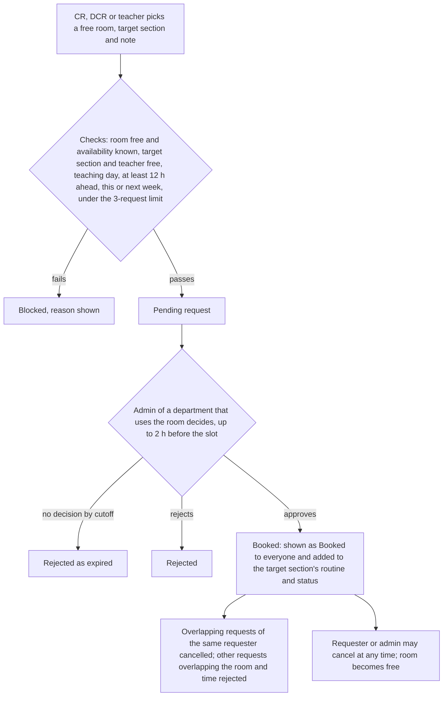

# Class & Routine Management — PRD

Oct 10, 2026 · @chinmoy · Revised Nov 1, 2026 (architecture readiness review)

A web platform where teachers and students sign in, keep profiles, chat one-to-one and in a section group, share study files, and read their level–term–section class routines.

A super admin and per-department admins run the system. Each department admin approves teachers, chooses each section's CR and DCR, and publishes routines for their own department.

The CR and DCR approve their section's students.

CRs, DCRs and teachers can request a free classroom at least 12 hours ahead, which the room's own department admin approves or rejects.

## Glossary

- **UV ID:** the student's institutional ID, issued offline by the university and unique to one student.
- **Level and term:** a student's place in the degree, for example 2-II is Level 2, Term II. A student moves up one term each semester.
- **Semester:** a named six-month period such as Spring 2026 or Fall 2026. Routines, CR/DCR roles and confirmations are tied to a semester. "Term" always means the academic step (I or II), never the calendar period.
- **Section and group:** a section is department + level + term + section letter (for example CSE 2-II-A). A group (G1, G2, …) is a split of a section for sessional (lab) classes only.
- **Batch:** all students of one department, level and term, who share the same routine rows in the import sheet.
- **CR and DCR:** the class representative and deputy representatives of a section, chosen by the department admin each semester.
- **Request and booking:** a room is first **requested**. When the department admin approves it, it becomes a **booking** and the room shows as Booked.
- **Institution time:** all dates, times, weeks and deadlines use the `Asia/Dhaka` timezone, read from the server, never the device clock. A **week** runs Sunday 00:00 to Saturday 23:59.
- **Slot owner:** the department that imported or created a routine slot. Only that department's admin can edit, delete or cancel it (see Routine file import).
- **Calendar event:** a dated entry such as a holiday, exam day or early closing that changes whether classes run (see University calendar).
- **Account state:** where an account is in its lifecycle, for example pending, active or unconfirmed. The state decides what the account can use (see Account states and access).

## Overview & goals

The product is one web app serving a single institution's teachers and students. It replaces scattered WhatsApp groups and printed routine sheets with one place to log in, keep a profile, message, read the class routine, and request free classrooms.

What it commits to:

1. Give every teacher and student a single sign-in and a profile. Phone and photo are editable. Level, term, section and group are set through the join request and accepted by the CR or DCR. CR/DCR status is shown.
2. Let students and teachers chat one-to-one with anyone, join their section's group chat, and share study files (see Chat). It is deliberately small and does not try to replace WhatsApp.
3. Let each department's admin approve teachers, choose each section's CR and DCR, and publish routines that each student sees filtered to their own department, level, term, section and sessional group.
4. Show which classroom is free at which time, and let a CR, DCR or teacher request a free room for this week or next week, at least 12 hours ahead, for the room's own department admin to approve.
5. Show each student, live, whether they are in class or free right now according to their routine, with a countdown to the next change. In a later release, let teachers see the in-class or free status of students in the sections they teach, including a "free now" list.

**How people and routines are identified.** Every student, section and routine is identified by five things: **department** (for example CSE), **level**, **term**, **section**, and, for sessional (lab) classes only, **group**. A section is department + level + term + section, for example "CSE 2-II-A", and its routine, its CR and its DCRs belong to that exact section. Wherever this document says "level, term and section" it means the department as well. Teachers belong to a department too, and a teacher is identified by department + short code.

Out of scope for the first version: attendance, grades/marks, fee payment, and parent accounts. These are noted so the data model leaves room for them later.

There are no elective courses to model: the university fixes every student's courses, and students cannot choose electives. A student's routine is fully decided by department, level, term, section and sessional group.

## Users & roles

There are two kinds of person account: **teacher** and **student**. **Admin** is a role added to an account, not a separate login. Admin has two levels, **super admin** (university-wide) and **department admin** (one department only), so no single person holds all the control. A department admin is usually a teacher of that department: they keep one account, with one email and password, that holds both the teacher role and the admin role. A super admin who does not teach has a staff account that holds only the admin role. CR and DCR are not separate account types — they are students given an extra role by their department admin, so everything a student can do, a CR or DCR can do too, plus the dashboard for their own section (including approving their classmates' UV ID claims).

| Role | Signs in with | Can do | Cannot do |
| --- | --- | --- | --- |
| Super admin (at least two accounts) | University email + password + second step (first one seeded; others granted by a super admin) | University-wide work: create and remove departments, create and remove department admins and other super admins, set the allowed email domains, create semesters and run the rollover, fix cross-department problems, read the full audit log, recover a department that has no admin. Can also do anything a department admin can, in any department | Be self-created from the sign-up page; remove the last super admin; read users' private messages |
| Department admin (one or more per department) | University email + password + second step (role granted by a super admin) | For their own department only: approve/reject teacher registrations, choose and remove each section's CR and DCR, approve ID claims that no CR/DCR can handle, handle CR/DCR flags and removal requests, deactivate students and teachers, reset student passwords, import and edit routines, manage classrooms, link teacher short codes, read their department's audit log | Act on another department; create or remove admins; create departments or semesters; be self-created from the sign-up page |
| Teacher (after admin approval) | University email + password | Edit own profile, chat one-to-one, share files, view own teaching routine, see which rooms are free, request a free room (12-hour rule; the room's department admin decides), see the roster of sections they teach. Later release: see the in-class/free status and "free now" list of those sections, and send announcements to them | Approve CR/DCR, publish routines, see students of sections they do not teach, use the app before the admin approves the account |
| Student | University email + password (the UV ID is claimed after sign-up) | Edit own profile, claim their UV ID, and once the CR or DCR approves the claim: chat one-to-one, use the section group, share files, view own level–term–section–group routine | Publish routines, approve others, apply to be CR/DCR, or use anything their account state does not allow (see Account states and access) |
| CR (student chosen by the department admin) | Same as student | Everything a student can, plus **request a free classroom** (the room's department admin decides), use the **CR/DCR dashboard** for their own section, and approve or reject UV ID claims from students of that section | Approve CR/DCR or teachers, publish or edit routines, delete or deactivate accounts, see other sections' students |
| DCR (student chosen by the department admin) | Same as student | Same as CR | Same as CR |

Notes:

- **Only the department admin of that department, or a super admin, approves or assigns teachers, CR and DCR; no other role can.** Teachers, students, CR and DCR have no way to approve, assign or remove these roles.
- A section has one CR and up to two DCRs. The system should block a second CR or a third DCR for the same section and tell the admin why.
- The UV ID is the student's institutional ID, issued offline and unique. Students do not pick it; they enter it after signing up to claim it, and the CR or DCR of their section approves the claim (see Student ID claim).
- The first super admin is seeded by whoever installs the system, and a second super admin must be created soon after so there is always a backup. Every other admin role is granted by a super admin to an existing, verified account. There is no public admin sign-up.
- **One person, one account.** An email belongs to exactly one account. An account can hold several roles (teacher + department admin, or student + CR). Any account that holds an admin role must pass the second step at every sign-in.

### Account states and access

Each account is in exactly one state. The state, not the screen, decides what the server allows. Every rule in this document that says a student or teacher "can" or "cannot" use something follows this table.

**Student states**

| State | Meaning | How it is entered | How it is left |
| --- | --- | --- | --- |
| `email_unverified` | Signed up, email not verified yet | Sign-up | Clicks the verification link → `claim_pending` |
| `claim_pending` | First-ever join request sent and waiting, or not yet sent | Email verified | CR/DCR accepts → `active`. A rejection keeps the account here so the student can apply again |
| `active` | Accepted into a section for the current semester | First acceptance, or re-acceptance after rollover | Rollover → `unconfirmed`. Graduation → `graduated` |
| `unconfirmed` | Was accepted in an earlier semester but not yet for the current one. Includes students on a break | A semester becomes current | CR/DCR accepts the new join request → `active` |
| `graduated` | Finished the degree | The student picks "I have completed my degree" on the update screen (only offered after 4-II), or the admin marks them | Admin can reverse it |
| `deactivated` | Removed by an admin. History is kept | Admin action | Admin reactivates |

**Teacher states:** `email_unverified` → `pending` (waiting for admin approval) → `active`. A teacher can also be `suspended` or `deactivated` by the admin.

**Chat suspension** is a separate flag, not a state. It stops only message sending, for the set time.

**What each state can use**

| Capability | `email_unverified` | `claim_pending` | `unconfirmed` | `active` student | `graduated` | Teacher `pending` | Teacher `active` |
| --- | --- | --- | --- | --- | --- | --- | --- |
| Sign in | Only to the verify screen | Yes | Yes | Yes | Yes | Only to the waiting screen | Yes |
| Edit own profile | No | Yes | Yes | Yes | Yes | Yes | Yes |
| Submit join request | No | Yes | Yes (semester update) | No (CR/DCR changes the group) | No | n/a | n/a |
| My routine, live status | No | No | No | Yes | No | No | Yes (own classes) |
| Free-room view | No | No | No | Yes | No | No | Yes |
| Room requests | No | No | No | Only CR/DCR | No | No | Yes |
| One-to-one chat | No | **Only with the CR and DCRs of the section they applied to** | Yes, with anyone | Yes | Yes, read and send | No | Yes |
| Section group | No | No | No (the old group stays read-only) | Yes | Old groups read-only | n/a | n/a |
| Share files | No | No | Yes, in one-to-one chats | Yes | No | No | Yes |
| Rosters | No | No | No | Only CR/DCR, own section | No | No | Sections they teach |

`deactivated` and `suspended` accounts cannot sign in. A `claim_pending` student can message only the CR and DCRs of the section they applied to, and only while the request is open. This lets them ask about the request without opening chat with everyone.

## Authentication & onboarding

Each role claims its account differently, but all land in the same profile editor afterward.

- **Teacher** signs up with a **university email + password** and verifies the email. The university email is their login from the start. The account then stays **pending** until the admin approves it (see Teacher approval); a pending teacher can sign in only to see a "waiting for admin approval" screen.
- **Student** signs up with a **university email + password** and verifies the email, like a teacher. After that they claim their unique UV ID in their profile (see Student ID claim). The email is used to sign in, for password recovery, and for the automatic messages the system sends to students.
- **Admin** (super admin or department admin) does not sign up as an admin. The first super admin's account is seeded at install. Every other admin role is granted by a super admin to an existing verified account. An account with an admin role signs in with its email and password, plus a second step.

First-login flow for a new teacher: sign up and verify email → wait for admin approval → complete profile → land on the dashboard.

First-login flow for a new student: sign up and verify email → fill in the join form (name, UV ID, department, level, term, section, sessional group; phone and photo optional) → the request goes to the CR and DCR of that section → wait for them to accept → land on the dashboard.

At the start of every new semester, a returning student must submit a new join form with their new level, term, section and sessional group, and the CR and DCR of that section accept it again (see Semesters and student updates and Sessional groups).

Password rules and recovery:

- Passwords are stored hashed (never plain text). The minimum is 8 characters with at least one letter and one number.
- **Sign-in throttling** replaces a hard account lock, because a hard lock would let anyone lock out a known user. Throttling is counted per account and per IP address. After 5 wrong tries, each new try waits longer (1 s, 2 s, 4 s … up to 5 minutes) and a CAPTCHA is shown. The account is never locked outright. The owner is emailed after 10 failed tries in an hour.
- Teacher and student recovery are both by email link. Because a student's email is required, every student can recover their own password. Admin reset remains only as a fallback for a student whose email address no longer works.

Required university email (students and teachers):

- Students and teachers must sign up with an email address on the university's domain; the allowed domain or domains are set by a super admin, starting with `baiust.ac.bd`. Other addresses, such as personal Gmail, are rejected at sign-up.
- A student cannot sign in until they verify their email by clicking a link sent to that address.
- Each email can belong to only one student account.
- A student can change their email later, but the new address must also be a university address and must be verified before it replaces the old one. If an email stops working (bounces), the student is asked to update it at next login.
- The email is used to send the student automatic messages from the system. All automatic emails come from one system sender address on a university-approved domain, sent through a transactional email provider with SPF, DKIM and DMARC set up. Whether this works must be confirmed before development (see Open questions).
- **Transactional email is part of the first release.** The emails are: email verification, password reset, join request accepted or rejected, semester update reminder, room request result, class cancelled, and routine changed. Announcements are added when announcements ship (later release). Students cannot turn these off, and chat messages are never emailed.
- **Batching:** routine-change emails are combined into one "your routine changed" email per person per import or per hour of edits, never one email per changed slot. All email goes through a queue with retries.
- **Link and code lifetimes:** an email verification link lasts 24 hours, a password reset link 1 hour, and an admin second-step code 10 minutes. Every link and code works only once.
- **Sessions:** a student or teacher session ends after 14 days without use. An admin session ends after 30 minutes idle or 12 hours in total. All sessions of an account end when its password changes or the account is deactivated.

### Student ID claim

A student's email only proves they own an inbox. The UV ID proves who they are at the university. Because UV IDs are sequential and easy to guess, a student does not become a student by typing an ID; the CR or DCR of their section has to approve it. The CR and DCR know their classmates, so they do not need a student list.

1. After verifying their email, the student fills in the **join form** in their profile: name, UV ID, department, level, term, section, and sessional group (if they know it). The student chooses these themselves, but only from sections that already have a CR assigned by the admin.
2. The only automatic check is that the UV ID is not already **approved** for another account. If it is, the request is blocked and the admin is told. A pending claim does **not** reserve the ID, so a student who guesses someone else's ID cannot block the real owner. If several pending claims name the same ID, each one shows a "duplicate pending claim" badge to the CR, DCR and admin. The system does not check the ID against any ID range or student list.
   - **ID format:** the UV ID is stored as text, with spaces and dashes removed and leading zeros kept. For the duplicate check only, leading zeros are ignored, because Excel drops them (`0822310205101077` and `822310205101077` are the same ID).
3. The request goes to the CR and DCRs of the department, level, term and section the student chose, as a **pending join request**. Until it is accepted the student sees a "waiting for approval" screen. They can edit their profile and message the CR and DCRs of that section about the request. They cannot see the routine, rooms, the section group or anyone else in chat (see Account states and access).
4. The CR or DCR sees the student's name, email, photo, UV ID, and the department, level, term, section and group they asked for. They decide whether the student belongs in that section, and can accept, reject (a reason is required for a rejection), or accept with a corrected sessional group. Whoever acts first decides, and the student is told by email.
5. On acceptance the account becomes active and the student enters that section; the routine appears automatically. The sessional group affects only sessional (lab) classes; theory classes depend on level, term and section only.
6. If the student chose the wrong section, the CR or DCR rejects the request with a reason and the student applies again to the right section.

Rules:

- A CR or DCR does not submit a join request for the section they lead: the admin's assignment is their approval (they must still have signed up and verified their email).
- A section with no CR is closed: it does not appear on the join form, and students cannot send a request to it until the admin has chosen its CR. DCRs are optional and can be added later.
- If nobody acts on a claim within 3 days, it moves to the department admin of that department.
- A student who failed a term cannot move up. Each semester they submit the join form again for the same level and term, and choose the section and group they will attend. The CR and DCR know who the repeat students are, so they accept them like any other student; no extra check is needed.
- If someone else claimed a student's ID, the real student reports it. The admin checks in person, can revoke the wrong claim, and the action is logged.
- A student who has 5 claims rejected is blocked from claiming for 24 hours. A rejected student can apply again, to the right section or with a corrected form, but cannot claim a UV ID that is already approved for another account.
- When the CR or DCR accepts a claim, any other pending claims for the same UV ID are rejected automatically with the reason "ID approved for another account", and the admin is told.
- Every claim, approval, rejection and revocation is logged with who and when.

## Core features

Each feature below is a requirement. The **Release** column is the cut line:

- **R1 (launch, target: Spring 2027 rollover, 4 Apr 2027):** accounts and onboarding, routine import/edit/publish, My routine, live status for students, the calendar, the free-room view (read-only), transactional email. Department setup for Spring 2027 is done in the draft semester during the break that starts 24 Feb 2027.
- **R2:** room requests and booking.
- **R3:** chat, file sharing and chat safety.
- **Later:** announcements, the in-app notification centre, teacher view of student status and the "free now" list, student removal requests, Ramadan timetable.

A dashboard card whose feature is in a later release is hidden until that release. Wherever this document says "later release", it means the release given in this table.

| # | Feature | What it does | Who | Release |
| --- | --- | --- | --- | --- |
| F1 | Profile editor | Edit phone and profile picture; submit the join form (name, UV ID, department, level, term, section, sessional group) for the CR/DCR to accept; **required, verified university email** (add and change); view CR/DCR status | Teacher, Student | R1 |
| F1a | Semester update | At the start of each semester (for example Spring 2026, then Fall 2026) the student must submit a new join form with their department, level, term, section and sessional group, and the CR/DCR of that section accept it. Until then the student is `unconfirmed` (see Account states and access) | Student | R1 |
| F1b | Sessional group assignment | The CR or DCR sets or corrects each student's sessional (lab) group (G1, G2, G3, …) when accepting the join request, and can change it later (logged); the group affects only sessional classes, never theory classes | CR, DCR | R1 |
| F2 | Direct messaging | One-to-one chat between users allowed by their account states, found by name search or from a profile; timestamps and sent/delivered/seen status (see Chat) | Teacher, Student | R3 |
| F2b | Chat safety | Block a user, report a message or user, delete own messages, chat suspension by the department admin (see Chat) | Teacher, Student, Admin | R3 |
| F3 | Section group | One group per section per semester, created automatically when the CR is named; accepted students are added automatically; teachers are not members; closed at rollover (see Chat) | Student, CR, DCR | R3 |
| F4 | CR/DCR assignment | The department admin chooses each section's CR and DCRs by hand (one CR, up to two DCRs); students do not apply | Department admin | R1 |
| F4a | Teacher registration approval | A new teacher account is held as pending until the department admin approves or rejects it | Teacher, Department admin | R1 |
| F4b | Student ID claim approval | A student submits a join form (UV ID, department, level, term, section, sessional group) after signing up; the request goes to that section's CR and DCR, who accept, reject, or correct the group | Student, CR, DCR | R1 |
| F5 | Approval dashboard | Department admin sees their department's pending teacher registrations and ID claims that need the admin, and manages CR/DCR assignments | Department admin | R1 |
| F5a | Admin dashboard and controls | One home page for each admin showing everything that needs attention in their scope (a department admin sees their department, a super admin sees all), plus the tools to manage semesters, routines, teachers, CR/DCR, students, classrooms, calendar events and departments, with an audit log | Department admin, Super admin | R1 |
| F5b | Admin accounts and scope | Super admin grants and removes department admin and super admin roles; every admin action is limited to the admin's own department (super admin: all); at least two super admins always exist | Super admin | R1 |
| F6 | Routine publishing | Department admin uploads the routine template and edits any slot their department owns on a routine page (add, edit, delete), then publishes routines per level–term–section | Department admin | R1 |
| F7 | Routine viewing ("My routine") | A student opens the app and automatically sees their own routine, picked from the department, level, term, section and sessional group the CR or DCR accepted, with no manual searching or filtering; a teacher sees their own classes | Teacher, Student | R1 |
| F7a | Full week routine on the dashboard | The student's dashboard shows their whole week (Sunday to Thursday) as a weekly grid, with today highlighted and the class happening now marked | Student | R1 |
| F7b | Student dashboard | One home page for a student showing live status and countdown, today's classes, the full week, rooms and profile reminders. Messages, announcements and notifications cards appear when those features ship | Student | R1 |
| F7c | Teacher dashboard | One home page for a teacher showing teaching status and countdown, today's classes, the week, section rosters and rooms. Student status, messages and notices cards appear when those features ship | Teacher | R1 |
| F7d | Teacher announcements | A teacher sends a message to a section or lab group they teach | Teacher | Later |
| F8 | Free-room view | Pick a date (this week or next week) and a time range and see which classrooms are free then, not only right now. Rooms whose availability is not known are shown as "Availability unknown" (see Classroom booking rules) | Everyone with `active` state | R1 |
| F9 | Room request | Request a free room for a dated time range, this week or next week, only if ≥ 12 hours ahead, with a note and a target section; a requester may send several requests. The room's department admin approves one request per room and time; approving cancels the requester's own overlapping requests and rejects other requests that overlap the same room and time (see Classroom booking rules) | CR, DCR, Teacher (requesters); Department admin, Super admin (deciders) | R2 |
| F9a | CR/DCR dashboard | A section-only dashboard for CR and DCR to monitor their section (roster, unconfirmed students, routine, live status, room requests) and act (request and cancel rooms, approve student ID claims, change groups, flag problems). Room request parts arrive in R2 and announcements later | CR, DCR | R1 |
| F9b | Section announcements | CR/DCR sends a message to the whole section or to one lab group | CR, DCR | Later |
| F9c | Student removal request | CR/DCR asks the department admin to deactivate a student; only the admin acts on it | CR, DCR, Department admin | Later |
| F10 | File sharing | Send PDF, Word, PowerPoint, Excel, text and image files (up to 5 MB) in one-to-one chats and section groups | Teacher, Student | R3 |
| F11 | In-app notification centre | Unread list of new messages, approval results, booking results and routine changes. **Transactional email for these events is R1, not part of F11** (see Authentication & onboarding) | Everyone | Later |
| F12 | Live class status | Shows whether a student is **in class** or **free** right now, computed from their published routine and the calendar; refreshes automatically every minute. A teacher sees their own teaching status in R1 and their students' status later (F14) | Student (own), Teacher (own) | R1 |
| F13 | Next-class countdown | While in class, counts down to the end of the class; while free, counts down to the start of the next class | Student, Teacher | R1 |
| F14 | Student status for teachers | Teacher sees the in-class or free status of students in the sections they teach, including a "free now" list filterable by level, term, section and group | Teacher | Later |
| F15 | University calendar | Super admins keep university-wide **calendar events** and department admins keep department-only events: holidays, preparatory leave, exam days, early closings ("classes up to 12 p.m.") and department events such as CSE FEST. Many events per semester. The department admin can also **cancel a single class** on one date. Outside the current semester's dates, status shows "No classes". Ramadan timetable is a later release (see University calendar) | Super admin, Department admin | R1 (Ramadan: Later) |

F9's requester scope is decided: only CR, DCR and approved teachers can request a room, and the room's own department admin decides (see Classroom booking rules).

## Admin dashboard and controls

Admins run the system. This section collects the admin duties, which are described piece by piece elsewhere in this document, into one place. Control is split so that no single person is a bottleneck or a single point of failure.

**Who the admins are**

- **Super admin:** works across the whole university. There are always at least two, so one can cover for the other. The first is seeded at install; the others are created by a super admin.
- **Department admin:** works for one department only. Each department has at least one, appointed by a super admin; a department can have more than one so absence does not block it.
- Admin roles cannot be obtained from the sign-up page.
- Every admin signs in with their own university email and password, plus a second step, because these accounts control everyone else's access. The second step is an authenticator-app code (TOTP), with an emailed one-time code as the fallback. A department admin who loses their password or second step is reset by a super admin, and a super admin by another super admin; every reset is logged. The owner names the second super admin at install, and a super admin appoints each department's first admin.
- **Emails to admins:** the first version has no admin reports or exports. Admins get only these system emails: their second-step code, password reset, and a **digest of waiting items** at 08:00 and 17:00 institution time whenever something is waiting (room requests, sorted by decision cutoff; teacher registrations; escalated ID claims; flags). Super admins are also emailed at once when a department has no active admin. Everything else is on the admin dashboard.
- Every admin action is checked on the server against the admin's department: a department admin cannot see or change another department's teachers, sections, students, rooms or routines.
- **Recovery:** if a department has no active admin, super admins are alerted and can act for it or appoint a new one. The last super admin cannot be removed or demoted.

**Super admin only**

- Create, rename and retire departments.
- Grant and remove department admin and super admin roles.
- Set the allowed university email domains.
- Create semesters (as drafts), make one current after checking department readiness, and archive the old one.
- Keep university-wide calendar events.
- Fix problems that cross departments, such as a teacher who works in two departments.
- Read the full audit log.

**Admin dashboard (home page)**

A department admin sees these cards for their department only; a super admin sees them for every department, with a department filter. Cards show what needs attention, newest first:

- **Teacher registrations waiting** for approval (F4a), with approve and reject.
- **ID claims that need the admin:** claims no CR or DCR acted on in time.
- **Reports from CR and DCR:** flags and removal requests.
- **Routine problems:** the errors and warnings from the last import that are still open.
- **Room requests waiting:** requests for rooms the admin owns, grouped by room and slot, oldest first. For each, the admin sees the requester's section or department, the note, and the requester's other requests for the same time.
- **Current semester:** its name and status. If a draft semester exists, a **readiness checklist** per department: sections created, routine imported and published with zero errors, a CR named for every section, rooms listed. A super admin sees every department's checklist next to the "Make current" button and is warned about departments that are not ready.
- **Departments without an active admin** (super admin only).
- **Unconfirmed students:** who has not been accepted into a section for the current semester, per section.
- **Recent activity:** the latest entries of the audit log.

**What the admin manages** (a department admin: their own department; a super admin: all departments)

- **Semesters:** a super admin creates the next semester as a **draft** (for example Spring 2027). During the break each department admin prepares it: import and publish the routine (which creates the sections and groups), and name each section's CR and DCRs. The super admin then makes it current (see Semesters and student updates).
- **Routines:** upload the import template and check the preview, edit any slot on the routine edit page, and publish (see Routine file import, Import template and checks, Routine edit page).
- **Teachers:** approve or reject registrations, suspend or remove a teacher, and link each teacher account to its department and short code (see Teacher approval).
- **CR and DCR:** choose and remove them for each section (see CR/DCR assignment).
- **Students:** search for a student, deactivate an account, mark a student graduated, handle a request such as "someone took my UV ID", set a student's sessional group by hand, and see members removed from section groups (see CR/DCR dashboard).
- **Classrooms:** the **only place where rooms are created**. Each department admin keeps their own department's rooms: a canonical room code (for example `311`, `LR-407B`), type (classroom or lab), and **aliases** (spellings used in sheets, such as `RN: 311` or `LR-407B: AI Lab`). The owning department's admin can add **sharing departments**. A shared room's requests can be decided by the admin of any department that owns or shares it (the first decision is final); a super admin handles disputes. Room capacity is not tracked. The routine import never creates rooms.
- **Room requests:** approve one request and reject the others for each room and slot (see Classroom booking rules).
- **Cancel a single class:** cancel one slot their department owns on one date (for example when a teacher is sick). The affected students and teacher are emailed, and the room becomes free for that slot. The routine itself is not changed.
- **Calendar events:** a super admin keeps university-wide events, and a department admin keeps events for their own department only, such as CSE FEST (see University calendar).
- **Departments:** a super admin keeps the list of departments used on the join form and in the routine.
- **Admin roles:** a super admin grants and removes admin roles (see F5b).

**Rules**

- **Audit log:** every admin action, including creating or removing an admin, is logged with who, when, and the old and new values. The log cannot be edited or deleted. A super admin can read all of it; a department admin can read only their own department's entries.
- **Confirmation:** destructive actions (deactivate an account, remove a role, publish a routine) ask the admin to confirm first.
- **Nothing is hard-deleted:** removing a student or teacher deactivates the account and keeps its history, so a mistake can be undone.
- **Private chats:** the admin cannot read users' private messages.
- **Server checks:** every admin action is checked on the server, not only hidden in the page (see Non-functional requirements).

## Student dashboard

The dashboard is the first page an `active` student sees after login. Everything on it is based on the student's level, term, section and lab group for the current semester. A `claim_pending` student sees the waiting screen and an `unconfirmed` student sees the update screen instead. Both screens show the CR/DCR card of the section the student applied to, with a message button once chat ships (see Account states and access). The page is a summary: each card links to the full feature.

**1. Right now (top of the page)**

- **Live status:** "In class" or "Free", from the routine and the calendar (F12). On Friday and Saturday it says "No classes today", and on calendar events it shows the event label (see Live class status).
- **Countdown:** time left in the current class, or time until the next one (F13), refreshed every minute.
- **Current or next class card:** course, the full name of the teacher for the student's group, room and time.

**2. Routine**

- **Today's classes** in time order, with the current one marked.
- **Full week grid** from Sunday to Thursday (F7a), with today highlighted.
- **Tomorrow preview:** the first class tomorrow and its start time, so the student knows when they must arrive.

**3. Notices**

- **Upcoming calendar events** for the next 14 days (holidays, exam days, early closings, department events), from the University calendar (F15).
- **Announcements** from the CR, DCR or a teacher who teaches the section, for the student's section or lab group (F7d, F9b; later release), newest first. A student can never mute announcements. There are no admin announcements in this version.
- **Notifications** for routine changes, approval results and room request results (F11; later release), with an unread count.
- **Unread messages** count for direct chats and groups (F2, F3; R3), linking to the chat.

**4. Rooms**

- **Free rooms now** from the free-room view (F8). Students can look but cannot request a room; only CR, DCR and teachers can.

**5. My section**

- **CR and DCRs** of the student's section, with a button to message them (R3).
- **Courses this semester** with the full name of the teacher of the student's group for each course, taken from the routine, so group-specific teachers are shown correctly.
- **ID claim status** while the claim is pending or rejected, and a link to the CR/DCR dashboard if the student holds the role.

**6. Profile reminders**

- **Level, term, section and sessional group** shown read-only, as accepted by the CR or DCR. To change section, level or term, the student sends a new join request. Only the CR, DCR or admin changes the group.
- **Semester badge** such as "Fall 2026 confirmed", with a warning when the update is overdue.
- **Email status:** a banner if the student's email is missing or unverified.
- **Group notice** if the CR or DCR has not set a sessional group yet (see Sessional groups).

Rules:

- Cards only show data the student is allowed to see. A student never sees another section's routine, bookings or student list; chat search shows only name, photo, department and role.
- The dashboard works on a phone first: cards stack in one column, and the week grid becomes a day-by-day list (see F7a).
- A card with nothing to show is hidden or shows a short empty message, never a blank box.
- Priority order on a small screen: status and countdown, today's classes, notices, rooms, section, profile reminders.
- The dashboard loads in under ~2 seconds and the status and countdown refresh on their own without reloading the page.

## Teacher dashboard

The dashboard is the first page an approved teacher sees after login (a pending teacher sees only the waiting screen; see Teacher approval). Everything on it is based on the classes assigned to the teacher's linked short code in the current semester's routine. Each card links to the full feature.

**1. Right now (top of the page)**

- **My status:** "Teaching" or "Free", from the classes assigned to the teacher (same rule as F12, applied to the teacher instead of a student). On Friday and Saturday it says "No classes today", and on calendar events it shows the event label.
- **Countdown:** time left in the current class, or time until the next one (F13), refreshed every minute.
- **Current or next class card:** course, section, lab group, room and time. For a lab shared with another teacher, both teachers' full names are shown.

**2. My routine (F7)**

- **Today's classes** in time order, across all sections, with the current one marked.
- **Full week grid** from Sunday to Thursday. A teacher teaches several sections and several lab groups of the same course, so each cell shows the course, section, group and room.
- **Next teaching day preview** when there are no more classes today.

**3. Students**

- **"Free now" list and student status (F14; later release):** students currently free or in class, filterable by level, term, section and group. For a teacher it covers only the sections they teach.
- **Section roster:** for each section the teacher teaches, the students with name, UV ID and lab group. A teacher cannot open the roster of a section they do not teach.

**4. Rooms (F8, F9)**

- **Free rooms:** the free-room view (F8) with a date and time picker, and (from R2) a request button next to each free room.
- **My room requests** (R2) and whether each is pending, approved, rejected, cancelled or expired (F9). A teacher may send several requests; the same rules apply as for a CR or DCR (see Classroom booking rules).

**5. Messages and notices**

- **Upcoming calendar events** for the next 14 days.
- **Unread messages** count (F2; R3), linking to the chat.
- **Notifications** for routine changes and approval results (F11; later release), with an unread count.
- **Announcements:** the teacher can send an announcement to a section or lab group they teach (F7d; later release). It is emailed to those students and logged with the sender and time.

**6. Account**

- **Linked short code and name** from the routine sheet. If the account is not yet linked, a notice asks the admin to link it.
- **Profile reminders** when email, phone or photo is missing.

What teachers cannot do or see:

- A student's location, messages or attendance, and any section's roster outside the sections they teach.
- Another user's private chats.
- Admin controls: approvals and routine import.

Rules:

- Cards only show data the teacher is allowed to see. Roster and announcement access is derived from the routine: a teacher qualifies for a section only if they are assigned to at least one of its slots this semester.
- Teachers are identified by department + short code. If the same code appears twice inside one department, the account cannot be linked until the admin fixes the import, and the dashboard shows the unlinked notice.
- The dashboard works on a phone first: cards stack in one column and the week grid becomes a day-by-day list.
- A card with nothing to show is hidden or shows a short empty message.
- It loads in under ~2 seconds and the status and countdown refresh without reloading.

## CR/DCR dashboard

CR and DCR have the same dashboard. It is scoped to **one section and one semester** (for example 3-II-A, Fall 2026). They never see another section's students. The dashboard is the only place where a student has more power than other students, and it ends at semester rollover with the role itself.

**Monitor (read-only views)**

- **Section roster:** every student in the section with name, UV ID, lab group, profile photo, and whether their profile is confirmed for this semester. Phone and email are never shown here (see Privacy for the one exception on join requests).
- **Unconfirmed students:** students who have not done the semester update, with a button to send them a reminder (limited to one reminder per student per day).
- **Section routine:** the published routine for the section, today's classes first, and which classes are happening now.
- **Live status:** whether the section, and each lab group, is in class or free right now, with the countdown (F12/F13).
- **Free rooms:** the free-room view (F8) with a date and time picker, and a request button next to each free room.
- **Room requests:** all of the section's room requests and whether each is pending, approved, rejected, cancelled or expired, with the reason.
- **Flags:** the status of anything the CR or DCR reported to the admin (open, fixed, rejected).

**Act**

- **Request a free room** for the section under the 12-hour rule (F9), several rooms if wanted, each with a note, and **cancel** the section's own request or approved room.
- **Send an announcement** to the whole section or to one lab group (F9b; later release). Announcements are also emailed to those students and are logged with the sender. They need no review before sending; the admin can see and remove them afterward.
- **Accept or reject join requests** from students of their section, and set each student's sessional group (see Student ID claim). The CR and DCR use what they know about their classmates; no student list or ID range is checked.
- **Change a student's sessional group** at any time during the semester. The change is logged, and the student is emailed.
- **Flag a problem to the department admin** (up to 5 a day), for example a student in the wrong section or group, a missing student, or a routine mistake. The admin sees the flag with who raised it and when.
- **Request removal of a student** (F9c; later release), up to 5 a day. The request says who and why. It does not delete anything, and the student is not told about the request.

**What a CR or DCR cannot do**

- Delete or deactivate any account. Only the admin can, and every removal is logged with who and when, so a mistaken request can be reversed. Student history is kept.
- Approve CR/DCR or teachers.
- Publish or edit routines.
- See students, bookings or flags of any other section.
- Change a student's profile, level, term or section. Section, level and term change only through a new join request from the student, or by the admin after a flag. (The **sessional group** is the one thing the CR and DCR can change; see Act.)

**Rules**

- Both CR and DCR can act. If two of them act on the same request, the first action wins and the other sees that it is already done.
- Every action on the dashboard is logged with who and when, and the admin can see the log.
- If a CR or DCR loses the role (end of semester, removed by the admin), the dashboard disappears at once and anything they started stays with the admin.
- **Checks on CR power:** members removed from a section group and rejected join requests are listed for the department admin. A removed or rejected student can appeal to the admin with one tap, and the admin can reverse the decision.

## Chat

Chat is deliberately small: one-to-one messages between any two people, one group per section per semester, and sharing of study files. It is not meant to replace WhatsApp as a general messenger, so it has no user-created groups, calls, stories or message search in the first version.

**Who can use chat.** Chat access follows Account states and access, which is the single source of truth. In short: `active` students, `unconfirmed` students (so a returning student can message their CR), `graduated` students and `active` teachers can message one another. Being a CR, DCR, teacher or admin makes no difference. A `claim_pending` student can message only the CR and DCRs of the section they applied to. Pending teachers and unverified accounts cannot open chat.

### One-to-one chat (F2)

- Any active user can chat with any other active user, in any section or department.
- **Finding people:** a user searches by name. The result shows name, photo, department and role (student, teacher, CR or DCR). It does not show level, term, section, group, phone or email. A user can also start a chat from a person's profile, the section roster, or the CR/DCR card on the dashboard.
- **What others see on a profile:** name, photo, department and role. Phone and email are never shown on a profile (see Privacy for the two exceptions on join and registration requests).
- A message is plain text up to 4,000 characters with a timestamp. In a one-to-one chat it shows sent, delivered and seen.
- A sender can delete their own message for everyone; it is replaced by "message deleted".
- One-to-one chats continue across semesters. They do not reset at rollover.

### Section group (F3)

- Every section has one group per semester, named like "CSE 2-II-A · Fall 2026".
- **Created automatically** when the department admin names the section's CR. The CR does not have to create it, so no semester starts without one.
- **Members:** the CR and DCRs (as group owners) and the section's accepted students, who are added automatically when the CR or DCR accepts their join request. Teachers are not members of any group.
- Only members can read or send. Students from other sections cannot join.
- The CR and DCR can delete any message and remove a member from the group. They cannot delete accounts.
- **At rollover** the group is closed: nobody can send, but the messages stay readable as history. A new group is created for the new semester as soon as the new CR is named, and students enter it when they are accepted into the section again. Students who move to a new section leave the old group and join the new one.
- Announcements (F7d, F9b) remain a separate one-way feature. They are not replaced by group posts.

### Sharing files (F10)

- Users can send a file in a one-to-one chat or in a section group, for example study material.
- Allowed types: PDF, Word (doc, docx), PowerPoint (ppt, pptx), Excel (xls, xlsx), plain text and images. Other types are rejected.
- Maximum size of one file: 5 MB. Files are scanned for malware (ClamAV) before they are available, and the real file type is checked from its content, not its extension. SVG images and macro-enabled Office files (`.docm`, `.xlsm`, `.pptm`) are rejected.
- A file is visible only to the members of that conversation or group, never through a public link. Files are kept in private storage and downloaded through short-lived signed links (5 minutes) as attachments, never shown inline.
- In a closed group, files stay downloadable as history.

### Safety (F2b)

Because anyone can message anyone, there are three light tools:

- **Block:** a user can block someone, who then cannot send them a message. A user cannot block an admin, and blocking does not stop announcements or notices.
- **Report:** a user can report a message or person with a reason. It goes to the department admin of the reported person (a super admin for admins). The admin sees only the reported message and a few messages around it, not the rest of the conversation.
- **Chat suspension:** a department admin can suspend a user from sending messages for a set time, with a reason. The user is told and the action is audited. Everything else in the app keeps working.

### Notifications

A new message adds an unread count on the dashboard and in the chat list, and a browser notification if the user allowed it. Chat messages are not emailed. Email is the only other channel, and it follows the list under Authentication & onboarding.

### Privacy and retention

- Messages travel over HTTPS and are encrypted on the server. They are not end-to-end encrypted in the first version, because reporting needs the server to produce a reported message.
- The admin cannot read private conversations. The only exception is the reported-message view above, and each such view is audited.
- Messages and files are kept for 12 months from the date they were sent (one-to-one chats span semesters, so retention is by send date). A nightly job then deletes them for good.
- A message deleted by its sender is removed from view at once and permanently erased after 30 days, unless a report refers to it. Reported messages are kept until the report is closed, plus 90 days.

## Teacher approval

Anyone can reach the teacher sign-up page, so a teacher account is not trusted until an admin checks it. Teachers are approved by the department admin of the department they register under (or a super admin), not by other teachers or students.

1. A teacher signs up with email + password and verifies the email.
2. The account is created as **pending**. The teacher can sign in only to a "waiting for admin approval" screen; they cannot message, see student profiles or see routines.
3. The admin sees the request in the approval dashboard (F5) with the teacher's name, email, department and short code (for example `MYA`). Approval is the admin's own judgment; no teacher list is needed.
4. The admin approves or rejects (a reason is required for a rejection). The teacher is told the result by email.
5. On approval the account becomes active, and the admin links the account to the teacher's short code from the routine sheet so the teacher's own classes appear in "My routine" (F7).
6. Approval and rejection are logged with who and when.

Rules:

- Only that department's admin or a super admin can approve teachers; there is no self-approval and no way to become admin through this flow.
- A rejected teacher can re-apply, but the admin sees the earlier rejection.
- The admin can later suspend or remove an approved teacher (for example when they leave the department).
- A teacher is identified by department + short code, so the same code in two departments (for example `AR` in CSE and in CE) is fine. The same department + code cannot be linked to two active accounts.

## CR/DCR assignment

The department admin chooses each section's CR and DCRs by hand. Students do not apply, because the admin knows who should lead each section.

1. The department admin opens the section (for example 3-II-A, Fall 2026) and picks a student who has signed up and verified their email. No approved ID claim is needed first: the admin knows who should lead the section, and the admin's choice is the approval.
2. The admin sets the role: CR or DCR.
3. The system blocks a second CR, or a third DCR, in the same section and tells the admin why.
4. The student sees the role on their profile and gets the CR/DCR dashboard. The assignment is logged with who and when.

Rules:

- A role belongs to one section and one semester. It ends at rollover and the admin chooses again for the new semester.
- The admin can remove a role at any time.
- A section opens for join requests only after the admin has named its CR. The admin names the CR and DCRs first, then students apply and the CR/DCR approve them.

## Classroom booking rules

A room is **requested**, not booked. A request becomes a booking only when the department admin of the room's own department approves it. Booking ships in R2.

**Availability must be known.** A room's free times are only correct if every department that uses it has published its routine for the current semester. A room is **availability known** when its owning department and every sharing department have a published routine for the current semester. Otherwise the free-room view shows it as **"Availability unknown"**, and it cannot be requested. This stops a room from showing as free just because the department that uses it has not imported yet. The launch plan should bring every department that shares rooms with CSE live together (see Open questions).

**Booked rooms.** As soon as a request is approved, the room shows as **Booked** for that date and time to everyone who can see the free-room view (F8): students, CR, DCR, teachers and admins. The request button is removed for that slot, and the server rejects any new request for it, even from a stale screen. Other users see only "Booked", not which section or teacher holds it. The room becomes free again only if the requester cancels (or the admin cancels the booking), and the free-room view updates at once.

**What an approved booking does.** The booking is tied to its target section (or group) and appears as a dated one-off class in that section's routine, My routine, and live status, so students no longer see "Free" during it. It also appears in the routine and status of the teacher who booked it, or of the teacher named on a CR/DCR request. The affected students and that teacher are emailed when it is approved or cancelled. It shows only on its date and never changes the weekly routine.

**Who can request:** CR, DCR and approved teachers. Ordinary students cannot. Each of them sees the free rooms on their own dashboard (F8) and sends the request from there.

**What a request is:** one room for one dated **time range** on one day. The routine repeats weekly, but a request is for a specific date, for example "Room 311, Wednesday 11 November 2026, 11:35–12:30".
- **Times:** start and end times are on 5-minute boundaries. They do not have to match the period grid, because some classes already run at their own times (for example LAW 10:30–12:00). A request lasts from 30 minutes to 3 hours, between 08:00 and 18:00.
- **Requester:** the requester is the **section** or the **teacher**. A CR or DCR sends a request on behalf of their section, and the system records which of them sent it.
- **Note and target:** the requester must write a short note saying why and must name the **target section**, plus the sessional group if only one group attends. A CR or DCR can only target their own section, and a teacher picks from the sections they teach. A request without a target is blocked.
- **Teacher on a CR/DCR request:** a CR or DCR may name the teacher who will take the class (optional), from the teachers of that section.

**Overlap** means two time ranges on the same date share any minute: `start₁ < end₂` and `start₂ < end₁`. Ranges that only touch, such as 10:00–11:00 and 11:00–12:00, do not overlap. Every rule below that says "same time" means overlap.

**Checks when a request is sent** (all must pass, otherwise it is blocked and the requester is told why). The server runs every check again when the admin approves.

1. **Room free:** no published routine class (that is not cancelled for that date) and no approved booking overlaps the room at that time. Other pending requests do not block it.
2. **Availability known:** the room is availability known (see above).
3. **Target free:** the target section, or the target group, has no routine class (that is not cancelled) and no approved booking overlapping the time. A whole-section class blocks every group, and a group's lab blocks a whole-section request.
4. **Teacher free:** the requesting teacher, or the teacher named on a CR/DCR request, has no class and no approved booking overlapping the time.
5. **Teaching day:** the date is Sunday to Thursday, inside the current semester, and not covered by a calendar event that stops classes (holiday, preparatory leave, exam day). On an early-closing day the range must end by the cutoff time.
6. **12-hour rule:** the request is sent at least 12 hours before the start time. Example: room 311 is used 10:30–11:25 and free 11:35–12:30. It can be requested for 11:35–12:30 until 23:35 the evening before.
7. **Window:** the date is in the current week or the next week (Sunday to Saturday, institution time). For example, on Monday 9 Nov 2026 the current week is 8–14 Nov, so a request can be for any date up to Saturday 21 Nov 2026.
8. **Limit:** see Several requests.

**Several requests:** a requester (a section, or a teacher) may have up to **3 open (pending) requests whose times overlap one another** on the same date, for different rooms, so that losing one room still leaves a chance at another. Requests at times that do not overlap are not limited. The limit is shared by the CR and DCRs of a section, so a section never has more than 3 overlapping requests open. The server counts them inside a transaction, so two CRs pressing at the same moment cannot go over the limit. When one of a requester's requests is approved, their other requests that **overlap** the approved time on that date are cancelled automatically, so nobody holds two rooms at once.

**Who decides:**

- Every room has an owning department, and that department's admin decides requests for it. A room shared by several departments is listed with every department that uses it, and the admin of **any** of those departments can decide its requests. The first decision is final and locks the request for the others. A super admin steps in only for a dispute.
- Requests for the same room and slot appear on the admin's dashboard oldest first. The order is only for display; the admin picks which section or teacher gets the room. The admin also sees the requester's other requests for the same time.
- Approving one request rejects the other pending requests that overlap the same room and time.
- **No double-booking, guaranteed by the database:** two admins of departments that share a room may press approve at the same moment. The database itself rejects any second approved booking that overlaps the same room (see Technical approach), and the slower admin sees "already decided".
- **Decision cutoff:** an admin can approve or reject a request only until **2 hours before the slot starts**. A request nobody has decided by then is **rejected automatically** as expired, so the requester can plan.
- Every requester is told the result. A requester who loses is told the room went to another section.

**Cancelling and no-shows:**

- A requester can cancel an approved room **at any time**, and the room becomes free for others again at once. A cancel made less than 6 hours before the slot is logged, so the admin can see patterns.
- The admin can add a note on an approved request after the slot if the requester did not use the room. The note stays on record for later decisions. No other penalty in the first version.

**When the routine or calendar changes:** if a routine edit or re-import would put a class in a room and slot with an approved request, the admin gets a warning naming the affected requester (see Routine edit page). If a new calendar event closes a day that has approved bookings, those bookings are cancelled and the requesters are emailed.

## Routine management

The department admin owns the routine of their department; everyone else reads it. A routine is a weekly grid of time slots mapped to a subject, a teacher and a classroom, scoped to one level–term–section.

How it works:

1. Admin creates a routine for a level, term and section — for example, Level 2, Term 1, Section A.
2. For each slot (day × time), admin assigns subject, teacher and room.
3. Admin publishes it. Publishing is what makes it visible to students and teachers.
4. A student opens "My routine" and sees only the routine for their own level, term, section and lab group — no manual filtering. The app uses the level, term, section and sessional group that the CR or DCR accepted (F1b), so the right routine appears as soon as they accept the student.

### Routine file import

The uploaded file is the starting point for the routine: classes, teachers, rooms and sessional groups. The app does not invent or guess any of it. Once it is imported, the routine in the app is the source of truth, and the admin can correct it on the routine edit page (see Routine edit page).

1. Every semester, a teacher gives the department's new Excel sheet to the department admin. The sheet changes every semester, so last semester's data is never reused.
2. The department admin uploads the filled import template to the new semester, normally while it is still a draft (see Import template and checks and Semesters and student updates). The "Level wise Student number" sheet is not used to place students.
   - **Sections and groups come from the import.** Each distinct department + level + term + section in the file creates that section for the semester, and each distinct group label creates that section's group. The admin can also add a section by hand. A batch with only one section and no letter in the sheet (for example `4-I`) is entered as section `A`.
3. Before publishing, the admin sees a preview and a list of problems found in the file (see the data-quality list in Import template problems, for example inconsistent batch labels or a short teacher code used by two people). The admin fixes the file or corrects the entries, then publishes.
4. Publishing is what makes the new routine take effect for the students of each section.
5. If the teacher later sends a corrected sheet, the admin re-imports it for the same semester. Before anything is replaced, the admin sees what would change, including any slots the admin edited by hand on the routine edit page, and chooses what to keep. This is logged with who and when, and affected students and teachers get one combined email (see Authentication & onboarding).
6. Only the department admin (or a super admin) can import. Teachers and students never edit the routine directly.

**Who owns a slot.** A department's sheet contains classes its teachers take, including classes for other departments' batches (for example `LAW (1-II)` or `CE (2-II) CSE-2218` in the CSE sheet). So:
- Every slot belongs to the **department that imported it** (the slot owner), whatever batch it is for.
- A batch's routine is the **union** of slots from every department. A LAW 1-II student sees the LAW department's own slots and the slots CSE imported for LAW 1-II.
- A re-import or edit replaces or changes **only the importer's own slots**. CSE can never overwrite or delete a slot LAW imported, and the other way round.
- A slot for another department's batch can be imported only if that batch's section exists for the semester. If it does not exist yet, the import creates it, and that department's admin sees it on their dashboard.
- **Cross-department duplicate warning:** if two departments import a slot for the same batch, day, overlapping time and course code, both admins see a warning and agree which one deletes theirs.

### Import template and checks

The department's current Excel sheet is made for people to read: merged cells, free-text times such as `(12.00pm- 2.00pm)`, notes inside cells, and labels like `4-I` that Excel turns into a date. A program cannot read it reliably. So the first version imports a **clean template**, and the department's sheet is copied into it once per semester. Reading the old layout directly is out of scope for the first version; it would be a project of its own (merged cells, special times, mangled labels). The department admin copies the sheet into the template once per semester, and the columns are those listed under Routine file import. There is no converter for the old sheet in the first version. Problems seen in the current sheet that the template avoids: inconsistent batch labels (for example `3-1-A` vs `3-I-A`, and `4-I` stored as a date), a duplicated `CSE-301 (G1)` slot in one row, and a short code (`AR`) used by both a CSE and a CE teacher without a department written on the class.

Template, one row per class slot, plain text with drop-down lists where possible:

- **Department** (for example CSE, EEE, CE, LAW), **level** (1–4) and **term** (I or II) as separate text columns, **section** (A, B, C; `A` for a one-section batch) and **group** (G1, G2, … or empty for the whole section). Classes for other departments' batches, such as Law or Civil students taught by CSE teachers, are normal rows with that batch's department, and the importing department owns them (see Who owns a slot).
  - Group labels are numbered across the batch in the source sheet (3-II-B has G3 and G4). They are kept as written and belong to the section in that row.
  - A section letter in brackets in the source sheet, such as `CSE-442 (B)`, means the whole section. It is entered as section `B` with an empty group.
- **Day** (Sunday to Thursday), **start time** and **end time** in 24-hour form (for example 12:00 and 14:00). A lab over several periods, or a class with its own time, is just one row.
- **Course code** (required, free text: codes such as `GED`, `06111203` or `CSE-2218` are valid, so no pattern is enforced) and **course name** (optional, because the source sheet has no course names).
- **Teachers**, each written as department:code (for example `CSE:AR`), separated by a plus sign when two teachers share a class. `TBA` is allowed.
- **Room:** a room code or alias that already exists on the Classrooms page.
- A second sheet lists the teachers (department, short code, full name). Rooms are not in the template; they are kept on the Classrooms page (see Admin dashboard and controls).

Checks run when the admin uploads the template. The admin sees the full list and the preview before anything is published.

The department's own sheet is planned together with its main teacher and does not contain real double-bookings. An overlap is therefore usually a legitimate combined class (two sections sitting together, or a shared lab), which takes one row per section with the same teacher, room and time. Overlaps are therefore warnings, not errors. They are still checked because the template is copied by hand from the Excel sheet each semester, and a typo in a time, room or teacher code would show up as an overlap.

Errors (publishing is blocked until fixed):

- **Unknown teacher:** a teacher code that is not in the teacher list (for example `AA` in the current sheet, which is probably a typo for `RBA`).
- **Unknown room:** a room that matches no room code or alias on the Classrooms page. The admin adds the alias, or asks the owning department to add the room.
- A missing required field, an unreadable day or time, an end time before the start time, or a day outside Sunday to Thursday.

Warnings (the admin can accept them):

- **Teacher overlap:** the same teacher has two classes that overlap in time on the same day. If the rows share the same room and time, the admin can confirm it as a combined class.
- **Room overlap:** the same room is used by two classes that overlap in time. The same confirmation applies for a combined class or a shared lab.
- **Section overlap:** a section or group has two classes at overlapping times, including a whole-section class that overlaps a group's lab.
- A teacher is `TBA`.
- The same course and group appear twice on one day (this would flag the duplicated `CSE-301 (G1)` in the current sheet).
- A class starts before 8:30 or ends after 17:30.
- **Cross-department duplicate:** another department already has a slot for the same batch, day, overlapping time and course code.
- **Approved booking clash:** a class would use a room and time that already has an approved booking.

Fixing is done in the template and re-uploading it. Nothing is published, and no student sees any change, until the admin publishes with zero errors.

### Routine edit page

The uploaded file can have mistakes, and the routine can change during the semester. So the admin does not have to upload a new file for every fix: after the import, the admin can change the routine on a web page.

- The page shows the routine of one department, level, term and section as a weekly grid, in the same layout students see. Slots owned by another department are shown greyed out with that department's name.
- The admin can **add** a class slot, **edit** its course, teacher, room, day, time or group, and **delete** it, but only for slots their department owns.
- Every add, edit and delete goes through the same conflict checks as the import (an unknown teacher or room is an error; a teacher, room or section overlap is a warning the admin can confirm). A change with an error cannot be saved.
- A change that puts a class in a room and slot with an **approved room request** is not an error, but the admin gets a warning naming the affected requester. The admin chooses whether to keep the class or cancel the request; the requester is told either way.
- Every change is logged with who, when, and the old and new values. The students and teachers affected are emailed, batched as described under Authentication & onboarding.
- A saved change on a published routine shows to students right away.
- Only the department admin of that department (or a super admin) can use this page. CR, DCR, teachers and students cannot edit the routine.

### Sessional groups

Theory classes are for the whole section, but sessional (lab) courses are split into groups so that each group fits a lab. For example, a 2-II batch has a Data Structures and Algorithms sessional that is split into G1, G2 and G3. Each group has its own teacher (or pair of teachers), day, time and lab room: G1 may be taken by one teacher on Sunday in one lab, G2 by a different teacher on Tuesday, and G3 by another teacher on Thursday. The course is the same, but the teacher, time and room are not. Two students in the same section can therefore have different routines, and see different teachers for the same course.

How a student's group is decided:

1. A student's routine is decided in this order: **level → term → section → group**.
2. The student chooses level, term and section on the join form and may suggest their group. The CR or DCR who accepts the request decides the final group, because they know which group each classmate belongs to. The system does not check the UV ID against any ID range.
3. The list of groups for each section (G1, G2, …) comes from the imported routine Excel sheet, so the CR or DCR picks from groups that really exist for that section.
4. The group applies only to sessional (lab) courses. Theory classes depend only on level, term and section.
5. A lab slot tagged with a group (such as `CSE-422 (G1)`) is shown only to students whose group matches, with that group's teacher (full name), time and room. Slots for the whole section (no group tag) are shown to everyone in it.
6. Because every group has its own teacher, the routine stores teacher, time and room per group, never per course. A teacher's own routine (F7) is built from the group slots they are assigned to, so a teacher can appear in several groups of the same course, and a student sees only their own group's teacher.

Edge cases the system must handle:

- **Student does not know their group:** they leave it empty and the CR or DCR sets it when accepting. Until a group is set, the student sees only the whole-section (theory) classes with a notice.
- **Wrong group:** the CR or DCR can change a student's group later, and the change is logged. This is the only profile field a CR or DCR can change (see CR/DCR dashboard).
- **Admin override**: the admin can set a group manually for one student, and that override is kept and logged.
- **Group changes between semesters** are expected, since groups differ by level and term.

Routines follow the semester: every semester (about six months) the admin publishes a new routine, and the old one is archived, not deleted, so history stays. The super admin sets the start and end dates of each semester.

### Semesters and student updates

Each six-month period is a named **semester**, for example Spring 2026 or Fall 2026. The admin creates the semester, publishes its routines, and marks it as the current one. A student's level, term, section and sessional group are only valid for one semester, because students move up (for example from 2-I to 2-II) and may change section or group. At each rollover the student submits them again and the CR and DCR of the new section accept them.

**Semester states:** `draft` → `current` → `archived`. Only one semester can be current at a time. A semester's start and end dates come from the academic calendar.

How the rollover works:

1. **Draft (during the break).** A super admin creates the next semester as a draft, for example Spring 2027 during the break that starts 24 Feb 2027. Students cannot see a draft. In the draft each department admin:
   - imports and publishes the routine, which creates the sections and groups,
   - names each section's CR and DCRs; for every section the admin sees who was CR and DCR last semester and can re-appoint them with one action or pick different people,
   - enters any department calendar events.
2. **Make current.** The super admin checks the readiness checklist for each department (see Admin dashboard) and makes the semester current. In that one step:
   - the old semester is archived, its CR and DCR roles end and its section groups close,
   - the draft's CR and DCR roles take effect and their section groups are created,
   - every `active` student becomes `unconfirmed`,
   - every section that has a CR opens for join requests.

   A department that was not ready can finish its setup after the semester is current. Until then its sections stay closed, and its students see "Your department is still setting up this semester".
3. The next time an `unconfirmed` student logs in, they see the semester update screen. They cannot use My routine, live status, rooms or the section group until they are accepted, but they can use one-to-one chat and their profile (see Account states and access). The screen is the join form, pre-filled with last semester's values and the suggested next term (for example 2-I becomes 2-II). The student fills in or changes level, term, section and sessional group, and the request goes to the CR and DCR of the section they chose, who accept it again.
   - A student whose last term was **4-II** also sees "I have completed my degree". Choosing it makes the account `graduated`, with no join request.
   - A student who is **not enrolled this semester** (on a break) can choose "Not enrolled this semester". They stay `unconfirmed`, get no reminders, and are left off the overdue list, until they send a join request.
3. When the CR or DCR accepts the request, the student's profile is stamped with the semester it was confirmed for (for example "Fall 2026").
4. From then on, everything the student sees is based on those five values (department, level, term, section and sessional group) for the current semester: their routine, the live in-class or free status and countdown, the section's CR and DCR, and the free-room view.
5. Last semester's values and routine stay in the student's history and are never overwritten.

Rules:

- A student who failed the term repeats the same level and term, so the suggested next term on the pre-filled form is changed back by the student. Their section and group may differ from last time, and the CR or DCR sets the group when accepting.
- A student who is on a break and has not confirmed sees only the update screen, their profile and one-to-one chat; the app does not guess their section.
- Students who have not confirmed within 14 days of the semester becoming current appear in an "unconfirmed students" list for the admin, so they can be followed up (except those who chose "Not enrolled this semester"). The deadline does not lock anyone out; an unconfirmed student stays on the update screen until accepted.
- A student's CR or DCR role belongs to a section and semester. It ends at rollover and the admin chooses the CR and DCR again for the new semester.
- The student's profile always shows the semester it was last confirmed for, so a wrong or stale section is easy to spot.

The routine is also the source of truth for free rooms: a room is free at a time when no published routine class and no approved booking uses it on that date, **and** its availability is known (see Classroom booking rules). When a calendar event stops classes, or a class is cancelled for that date, the routine does not use the room. Room requests are still not allowed on days when classes are stopped.

### My routine (student view)

- **Automatic:** the student never chooses a routine. The routine follows the level, term, section and sessional group the CR or DCR accepted, and the app shows the matching published routine.
- **Today first:** the page opens on today's classes, then offers the full week (Sunday to Thursday). Each class shows time, subject, the teacher's full name and room.
- **Full week on the dashboard (F7a):** the student's dashboard has a weekly routine, so they do not need to open another page to plan their week.
  - It is a grid with the days (Sunday to Thursday) as rows or columns and the time slots (8:30–9:25 up to 4:35–5:30) on the other axis, matching the layout of the department's Excel sheet.
  - Each filled cell shows the course code, the full name of the teacher for the student's own group (the short code if the cell is too small, with the full name shown on tap), and the room. Empty cells are free periods.
  - A lab that runs for several periods is shown as one block across those periods, and classes with their own time (for example 12:00–3:00) are placed at that time.
  - Today's column or row is highlighted, and the class happening right now is marked, with the live status and countdown (F12/F13) shown above the grid.
  - It shows only the student's own section and group, so classes of other groups are never listed.
  - On a phone, the grid switches to a day-by-day list with swipe or tabs between days, because a nine-period grid does not fit a narrow screen.
  - The week shown is always the current semester's published routine, and it updates when the admin imports a changed sheet.
- **Group-aware:** a lab tagged for one group (for example G1) is shown only to that group. Classes for the whole section are shown to everyone in it.
- **Teacher names:** wherever a class is shown to a student, the teacher is shown by **full name** (for example "Arifur Rahaman"), not only the short code from the sheet. The app finds the name by looking up the short code, together with the department, in the teacher list of the import template. A class with two teachers shows both names. If the teacher is `TBA`, it shows "Teacher to be announced". Where there is very little space, such as a cell in the week grid, the short code may be shown and the full name appears when the student taps the cell.
- **Always current:** when the admin publishes a changed routine, an open page picks up the change within 5 minutes (or at once when the server pushes a change event), with no action by the student. Archived routines from earlier terms are not shown here.
- **Missing data:** if the student's join request is not accepted yet, the page shows the waiting screen. If no sessional group has been set yet, the page shows the whole-section classes with a notice that the CR or DCR must set a group, instead of showing a wrong routine.

## University calendar

The real academic calendar has more than holidays and one exam period. The 2026–27 calendar has preparatory-leave blocks, mid-term exam days mixed in with normal teaching days, "Campus Day (class up to 12 p.m.)" early closings, and department-only events such as CSE FEST. So the calendar is a list of **calendar events**, and live status, the free-room view and booking all read from it.

**A calendar event has:**

| Field | Meaning |
| --- | --- |
| Scope | **University** (set by a super admin) or **one department** (set by that department's admin) |
| From date, to date | An inclusive date range. One day is from = to |
| Kind | `holiday`, `prep_leave`, `exam`, `early_closing`, or `dept_event` |
| Cutoff time | Only for `early_closing`, and optionally for `dept_event`: classes stop at this time, for example 12:00 |
| Label | Shown in status, for example "Eid-ul-Fitr", "Preparatory leave", "Mid-term exam", "Campus Day", "CSE FEST" |

**What each kind does:**

- `holiday`, `prep_leave`, `exam`: no regular classes all day for everyone in scope. Status shows the label, such as "Holiday: Eid-ul-Fitr" or "Mid-term exam". Rooms cannot be requested, and approved bookings on those dates are cancelled.
- `early_closing`: classes before the cutoff run as normal, and classes that start at or after the cutoff do not run. A class that is running at the cutoff ends at the cutoff.
- `dept_event`: like a holiday for one department's students and slots, or like an early closing if it has a cutoff. Other departments are not affected.

**Rules:**

- There can be any number of events per semester, and events can overlap. Where they overlap, the strictest one wins (a full-day stop beats an early closing).
- A department admin cannot create or change university events. A super admin can create events for any scope.
- Creating or changing an event that affects existing approved bookings shows the admin the list of affected bookings first.
- Students and teachers see events for the next 14 days on their dashboard.
- **Single-class cancellation** stays a separate action: a department admin cancels one slot their department owns on one date.
- **Ramadan timetable (later release):** a super admin enters the date range and one table that maps each regular class time to its Ramadan time, for the whole university. Ramadan does not overlap teaching weeks in 2026–27, so this can wait.
- Outside the current semester's start and end dates, status shows "No classes".

## Live class status

The routine already says who has which class when, so the app can also answer "what is this student doing right now?" without any extra data entry.

How status is decided (F12):

1. Take the student's level, term, section and sessional group, as accepted by the CR or DCR.
2. Take the current day and time in the institution's timezone (Bangladesh time), not the viewer's device clock.
3. Look in the student's published routine for a slot on that day whose start–end time contains the current time.
   - A match means **In class**. Show the subject, the teacher's full name, room and end time.
   - No match means **Free**. Show when the next class starts.
4. A class applies to a student if it is for their whole section, or for their lab group. Lab slots tagged with a group (for example G1 or G2) apply only to that group; the same section can be in a lab and free at the same time.
5. Apply the calendar (see University calendar, F15):
   - On a full-day event that covers the student's department, the status shows the event label (for example "Mid-term exam") instead of "Free".
   - After an early-closing cutoff, the status shows "Classes over today: Campus Day".
   - Outside the current semester's dates, the status shows "No classes".
   - A class the department admin has **cancelled for that date** shows as cancelled and counts as free time.
   - An **approved booking** for the student's section or group counts as a class.
   - On non-teaching days (the routine runs Sunday to Thursday) the status shows "No classes today" rather than "Free".
   - The countdown always points to the next class that will really run, skipping event days.

Countdown (F13):

- **In class:** "Class ends in 25 min".
- **Free:** "Next class CSE-421 with Arifur Rahaman in 1 h 10 min, Room 311". If there are no more classes today, it counts down to the first class of the next teaching day.
- The status and countdown refresh on their own every minute while the page is open. No manual reload is needed.

**How it stays correct on an open page:**

- The page loads the student's routine for the current and next teaching day, the calendar events and the bookings, together with the **server time**. It works out the difference between the server clock and the device clock once, and uses that difference for every later calculation. A wrong device clock therefore never changes the status.
- Each minute's update is computed on the page, without a server call.
- The page fetches the day's data again every 5 minutes. It also fetches at once when the server pushes a "routine, booking or calendar changed" event for the student's section (when real-time messaging is available), and whenever the tab becomes visible again.

"Free now" list and student status for teachers (F14, later release):

- A teacher opens a list of students who are free at this moment, with the time each one's next class starts, so the teacher can see who is available, for example for a makeup class or a meeting.
- The list can be filtered by level, term, section and group, and switched to show who is in class.
- Because status comes from the section and group routine, every student in the same section and group shows the same status. An individual student's status is only as accurate as the section and group the CR or DCR accepted.
- Teachers see only what the routine implies (in class or free), never a student's location, messages or attendance.

**Scope notes for live status.** In R1, students see their own status and teachers see their own teaching status. When F14 ships, teachers will see whether a student in their sections is in class or free, and students cannot hide it. Calendar events and single-class cancellations are in R1 (F15), and upcoming events are listed on the dashboards. Real-time alerts for a class cancelled or moved to another room, beyond the email, are left out of the first version.

## Non-functional requirements

**Targets**

| Area | Target |
| --- | --- |
| Users | Up to 6,000 accounts at launch (CSE alone has about 720 students). Design for 15,000 |
| Peak load | 2,000 people opening the app within 5 minutes before the 08:30 first class; 100 requests per second sustained |
| Page speed | Dashboard, My routine and free-room view under 2 s at the 95th percentile on a mid-range Android phone on 4G |
| Chat delivery (R3) | Under 2 s at the 95th percentile |
| Uptime | 99.5% between 07:00 and 18:00 institution time, Sunday to Thursday. Maintenance outside those hours |
| Backups | Database backed up daily, with point-in-time recovery for 7 days and a copy kept off the server. Most data that can be lost (RPO): 24 hours, under 15 minutes with point-in-time recovery. Time to restore (RTO): 4 hours. A restore is tested once each semester |
| Browsers | The latest two versions of Chrome, Edge, Firefox, Safari and Android Chrome. Phone screens from 360 px wide |
| Accessibility | WCAG 2.1 AA |
| Language | English in the first version. All text kept in a translation file, so Bangla can be added later |
| Timezone | `Asia/Dhaka` for all logic. Times stored in UTC. Never hard-code +6 |

**Requirements**

- **Security.** Passwords hashed with argon2id. All traffic over HTTPS, with HSTS. Role checks enforced on the server, not just hidden in the UI: a student cannot reach admin actions by guessing a URL. CSRF protection on every change. Sign-in throttling as described under Authentication & onboarding.
- **Privacy.** A user's phone number and email are visible only to that user on their own profile. No other user can see them, including students, CR, DCR, teachers and admins; there is no setting to share them. There are only two exceptions, both limited to the person deciding a request: the CR or DCR sees a student's email on that student's join request, and the admin sees a teacher's email on that teacher's registration request. Everywhere else (rosters, profiles, chat, admin lists) admins see only whether an email is verified or bouncing, never the address. Email is used only to identify the user, for recovery, and for the system's own automatic messages to that user, never shared externally.
- **Stored data.** Passwords are hashed (bcrypt or argon2) and cannot be read back. Email and phone cannot be hashed for storage, because the system must read them back to send mail and to show them to the owner; they are stored encrypted, with the key kept outside the database. A separate **keyed hash (HMAC-SHA256, with a secret key kept outside the database)** of the lower-cased email is used to check that an address is not already taken and to find the account at sign-in. A plain hash is not used, because university emails are easy to guess and a plain hash could be reversed.
- **Authorization.** Every routine-edit, approval and booking action is checked against the caller's account state, role and scope (a CR can request rooms and approve their own section's ID claims; only a department admin, for their own department, or a super admin chooses CR/DCR). Every admin action is also checked against the admin's department. All checks go through one central policy function, `can(user, action, resource)`. Every role has tests that try to reach other sections' and departments' data. "Sections a teacher teaches" is always worked out on the server from the routine, never taken from what the page sends.
- **Performance.** Each section's weekly routine is cached and cleared on publish or edit, so the 08:30 peak is served from the cache. Live status and countdown are computed on the page (see Live class status).
- **Platform.** Responsive web app that can be installed on the home screen (PWA), and works on phone and desktop browsers. No native app in the first version.
- **Availability & data.** Backups as in Targets. Archived routines are kept, and chat history is kept as set under Privacy and retention.
- **Background jobs.** These run in a job queue, with retries and a record of any job that failed:
  - booking expiry at 2 h before the start time,
  - claim escalation after 3 days,
  - email sending and digests,
  - malware scanning of files,
  - the nightly retention purge,
  - the rollover.
- **Auditability.** Admin approvals, rejections, CR/DCR assignments, ID claim approvals and revocations, routine publishes, creation or removal of admin accounts, chat suspensions, and every admin view of reported chat messages are logged with who and when.

## Technical approach

This is the recommended approach for a team of 2–3 developers, one institution and a few thousand users. Changing it is fine, but the **data rules** below must hold whatever stack is used.

- **Shape:** one application (a modular monolith), split into modules: identity and auth, organisation (department, semester, section), routine and import, calendar, rooms and booking, chat, notifications, audit. No microservices.
- **Stack:** TypeScript end to end. A Next.js (React) front end, with a NestJS or Fastify back end. Django with Django REST Framework is an equal choice if the team knows Python better.
- **Database:** PostgreSQL 16. Its range types and exclusion constraints make double-booking impossible at the database level.
- **Supporting services:**
  - Redis for sessions, rate limits, cache and push events.
  - A job queue: BullMQ, or Celery with Django.
  - S3-compatible private file storage: MinIO on a university server, or Cloudflare R2.
  - ClamAV for malware scanning.
  - A transactional email provider: Amazon SES, Postmark or Brevo.
  - WebSocket for chat and "something changed" push events only. Everything else is plain REST.
- **Hosting:** one server (a VPS or a university virtual machine) running Docker Compose, with database backups kept off the server. Expected cost is roughly USD 20–60 a month.

**Core data model**

| Table | Key fields and constraints |
| --- | --- |
| `user` | id, kind (student, teacher, staff), state, `email_enc`, `email_hmac` (unique), `phone_enc`, `password_hash` |
| `user_role` | user_id, role (super_admin, dept_admin, teacher, cr, dcr), department_id?, section_id?, semester_id? |
| `department` | id, code (unique), name, retired |
| `semester` | id, name, status (draft, current, archived), start_date, end_date. **At most one current** (partial unique index) |
| `section` | semester_id, department_id, level, term, letter. Unique on all five |
| `section_group` | section_id, label. Unique per section |
| `enrolment` | user_id, semester_id, section_id, group_id?, status (pending, accepted, rejected), decided_by, decided_at. **At most one accepted per user per semester** |
| `uv_claim` | user_id, uv_id_text, uv_id_norm, status. **Unique uv_id_norm where status = approved** (pending claims do not reserve) |
| `teacher` | department_id, short_code, full_name, user_id?. Unique (department_id, short_code); user_id unique when set |
| `room` | id, code (unique), type, owner_department_id |
| `room_share` | room_id, department_id |
| `room_alias` | alias (unique), room_id |
| `routine_slot` | semester_id, owner_department_id, section_id, group_id?, day_of_week, start_time, end_time, course_code, course_name?, room_id, source (import, manual), combined_key?, published |
| `routine_slot_teacher` | slot_id, teacher_id |
| `calendar_event` | scope_department_id? (empty = university), from_date, to_date, kind, cutoff_time?, label |
| `class_cancellation` | slot_id, date, reason. Unique (slot_id, date) |
| `room_request` | requester_section_id or requester_teacher_id, sent_by_user_id, target_section_id, target_group_id?, named_teacher_id?, room_id, `period` (tstzrange), status, decided_by, version. **`EXCLUDE USING gist (room_id WITH =, period WITH &&) WHERE status = 'approved'`** |
| `conversation`, `conversation_member`, `message`, `file`, `report`, `block`, `chat_suspension` | Chat (R3) |
| `audit_log` | actor, action, scope_department_id, target, old_value, new_value, at. **Append-only**: the application's database user has no UPDATE or DELETE right on it |

**Concurrency rules**

- Every "first action wins" decision (join request, ID claim, room request) is a conditional update, such as `UPDATE … SET status = 'accepted' WHERE id = ? AND status = 'pending'`. If no row changes, the user sees "already decided".
- The 3-request limit is counted after locking the requester (`SELECT … FOR UPDATE`) in the same transaction as the insert.
- Approving a booking happens in one transaction: approve, cancel the requester's overlapping requests, and reject other requests overlapping the same room and time. The exclusion constraint is the last line of defence.

**Key API surface** (REST; exact shapes are decided in the API spec)

- Auth: `POST /auth/signup`, `/auth/verify`, `/auth/login`, `/auth/second-step`, `/auth/reset`
- Join and claims: `POST /enrolments`, `POST /enrolments/{id}/decision`, `PATCH /enrolments/{id}/group`
- Import: `POST /semesters/{id}/imports` (upload) → `GET /imports/{id}/preview` (errors, warnings, diff) → `POST /imports/{id}/publish`
- Routine: `GET /me/routine?from=&to=` (slots, cancellations, bookings, events and server time), `PUT/POST/DELETE /slots/{id}`
- Calendar: `GET/POST/PATCH /calendar-events`, `POST /slots/{id}/cancellations`
- Rooms: `GET /rooms/availability?date=&from=&to=`, `POST /room-requests`, `POST /room-requests/{id}/decision`, `POST /room-requests/{id}/cancel`
- Push events (WebSocket): `routine.changed`, `booking.changed`, `calendar.changed`, `message.new`, `message.status`

## Acceptance criteria

These cover the rule-heavy parts. Each one becomes an automated test. Times are institution time.

**Account states**

- Given a `claim_pending` student, when they open My routine, the free-room view or the section group, then the server refuses (403) and the page shows the waiting screen.
- Given a `claim_pending` student who applied to CSE 2-II-A, when they message that section's CR, then it is delivered. When they message anyone else, then it is refused.
- Given an `unconfirmed` student, when they send a one-to-one message, then it is delivered. When they open My routine, then they see the update screen.

**UV ID claims**

- Given student A's pending claim for `0822310205101077`, when student B claims `822310205101077`, then both claims are pending with a "duplicate pending claim" badge.
- When the CR accepts A's claim, then B's claim is rejected automatically and the admin is told.

**Booking**

- Given room 311 is free 11:35–12:30 on Wed 11 Nov 2026, when a CR requests it at 23:34 on Tue 10 Nov, then it is accepted. At 23:36, then it is blocked by the 12-hour rule.
- Given a section with 3 open requests overlapping 11:00–12:00, when a DCR of that section sends a 4th overlapping request, then it is blocked. A request for 14:00–15:00 the same day is accepted.
- Given two pending requests for room 311, 11:35–12:30, from sections X and Y, when admins from two sharing departments approve them at the same moment, then exactly one is approved and the other admin sees "already decided".
- Given an approved request for X at 11:35–12:30, then X's other requests overlapping that time are cancelled, and Y's request for room 311 at an overlapping time is rejected.
- Given section X has a lab 11:35–13:15 for G1, when a teacher requests a room for all of X at 12:00–13:00, then it is blocked ("target section has a class").
- Given a pending request with no decision by 2 hours before its start, then it becomes "expired" and the requester is emailed.
- Given a room shared with EEE while EEE has not published its routine for the current semester, then the room shows "Availability unknown" and cannot be requested.

**Calendar and live status**

- Given a university `exam` event on Mon 7 Jun 2027, then every student's status that day shows "Mid-term exam" and no room can be requested.
- Given an `early_closing` event with cutoff 12:00, then a class from 11:35 to 12:30 shows as in class until 12:00, then "Classes over today".
- Given a CSE `dept_event` (CSE FEST), then CSE students see the label while EEE students see their normal status.
- Given a device clock 20 minutes fast, then the status still matches server time.

**Import and ownership**

- Given CSE imported a slot for LAW 1-II, when the LAW admin re-imports their own file, then the CSE slot is untouched and LAW students see both departments' slots.
- Given a template row with room `RN: 311`, where `RN: 311` is an alias of room `311`, then the row imports into room `311`. Given an unknown room, then publishing is blocked.

**Rollover**

- Given Spring 2027 is a draft with CSE ready and EEE not ready, when the super admin makes it current, then a warning names EEE. After confirming: all `active` students become `unconfirmed`, Fall 2026 CR roles end, CSE sections open, and EEE sections stay closed.

## Open questions

These must be answered before the related work starts. Each has an owner.

1. **University email (blocks R1 onboarding). Owner: project owner, with university IT.** Does every current student, including older batches with 7-digit and 16-digit IDs, have a working `@baiust.ac.bd` mailbox? Will university mail accept mail from an outside email provider without sending it to spam? Which sender address and domain will be used? If some students have no mailbox, decide the fallback before launch.
2. **Launch scope (blocks R2 booking). Owner: project owner, with department heads.** Which departments go live at the Spring 2027 rollover? CSE's routine uses rooms that EEE, CE and Sc & Hum also use (EEE Lab, Physics, Chemistry and Civil labs, and rooms 309, 405, 501, 506 and 510). Until those departments publish their routines, those rooms show "Availability unknown". The recommendation is to bring every department that shares rooms live together.
3. **Blocked periods. Owner: CSE routine coordinator.** The routine sheet has a "No class Allowed" legend (for example prayer or lunch times). Should these periods be modelled so that no class or booking can be placed in them?
4. **Teachers in two departments. Owner: super admin.** Can one teacher account be linked to short codes in two departments (for example a CSE teacher who also teaches in EEE)? The data model allows it; confirm that it should.
5. **Hosting and budget. Owner: project owner.** University server or a rented VPS, and who pays for the email provider and storage?

New questions are added here as they come up.
