# Class & Routine Management — User Manual

This manual explains how to install, sign in to and use the Class & Routine Management system at BAIUST. It covers every kind of user: visitors, students, CRs and DCRs, teachers, department admins and super admins. It also explains how each part of the system works behind the screen.

Source of truth: `Class and Routine Management - PRD.md`. If this manual and the PRD disagree, the PRD wins.

---

## Contents

1. [What the system does](#1-what-the-system-does)
2. [Who uses it (roles)](#2-who-uses-it-roles)
3. [How the whole system fits together](#3-how-the-whole-system-fits-together)
4. [Setting up the system (installer / super admin)](#4-setting-up-the-system-installer--super-admin)
5. [Getting in: sign-up, verification and sign-in](#5-getting-in-sign-up-verification-and-sign-in)
6. [Student guide](#6-student-guide)
7. [CR and DCR guide](#7-cr-and-dcr-guide)
8. [Teacher guide](#8-teacher-guide)
9. [Department admin guide](#9-department-admin-guide)
10. [Super admin guide](#10-super-admin-guide)
11. [How the main features work](#11-how-the-main-features-work)
12. [Account states: what each one can use](#12-account-states-what-each-one-can-use)
13. [Page map (where to find things)](#13-page-map-where-to-find-things)
14. [Privacy and safety](#14-privacy-and-safety)
15. [Troubleshooting and FAQ](#15-troubleshooting-and-faq)
16. [Semester calendar: the yearly routine](#16-semester-calendar-the-yearly-routine)

---

## 1. What the system does

One web app replaces scattered WhatsApp groups and printed routine sheets. In it you can:

- Sign in once and keep a profile.
- See your **own class routine** automatically (no searching).
- See, live, whether you are **in class** or **free**, with a countdown to the next change.
- See which **classrooms are free** and **request** one.
- **Chat** one-to-one, join your **section group** and share study files.
- Read the **university calendar** (holidays, exams, early closings).

It works on a phone first (360 px wide and up) and on a computer. All times are **Bangladesh time (`Asia/Dhaka`)**, read from the server, so a wrong clock on your phone never changes what you see. A week runs **Sunday to Saturday**, and classes run **Sunday to Thursday**.

Not included: attendance, grades, fee payment and parent accounts.

### Release stages

| Release | What it adds |
| --- | --- |
| R1 | Accounts and onboarding, routine import, edit and publish, My routine, live status, calendar, free-room view, system emails |
| R2 | Room requests and booking |
| R3 | Chat, file sharing, chat safety (the current release) |
| Later | Announcements, notification centre, teachers seeing student status, student removal requests, Ramadan timetable |

Cards for features that have not shipped yet are hidden.

---

## 2. Who uses it (roles)

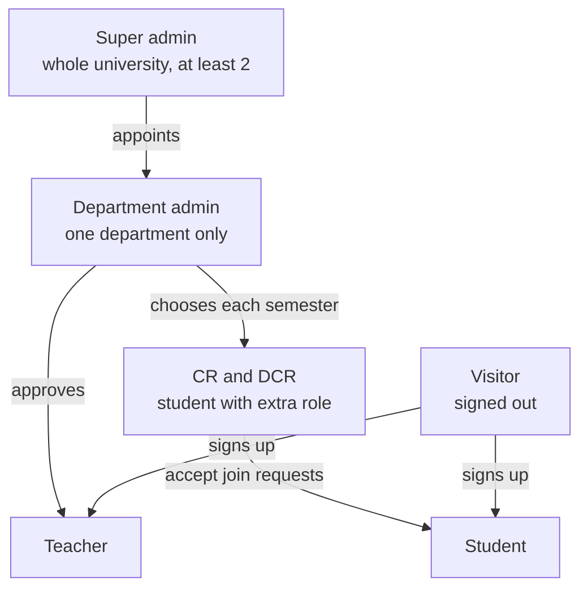

| Role | How they get the role | In one line |
| --- | --- | --- |
| Visitor | Nothing needed | Sees the public landing page with example data only |
| Student | Signs up with any email | Reads own routine, status, rooms; chats once accepted into a section |
| CR / DCR | Chosen by the department admin for one section and one semester | A student plus a section dashboard, join-request approval and room requests |
| Teacher | Signs up with a university email, then an admin approves | Own teaching routine, rosters of sections taught, room requests, chat |
| Department admin | Granted by a super admin to an existing verified account | Runs one department: teachers, CR/DCR, routines, rooms, calendar |
| Super admin | The first is created at install; others are granted by a super admin | Runs the whole university: departments, semesters, admins, audit log |

Important points:

- **One person, one account, one email.** One account can hold several roles (for example teacher + department admin, or student + CR).
- **There is no public admin sign-up.** Admin roles are only granted from inside the system.
- **Admins sign in with email and password only.** There is no second step.
- Only the right admin can approve teachers or assign CR/DCR. Teachers, students and CRs cannot.

---

## 3. How the whole system fits together

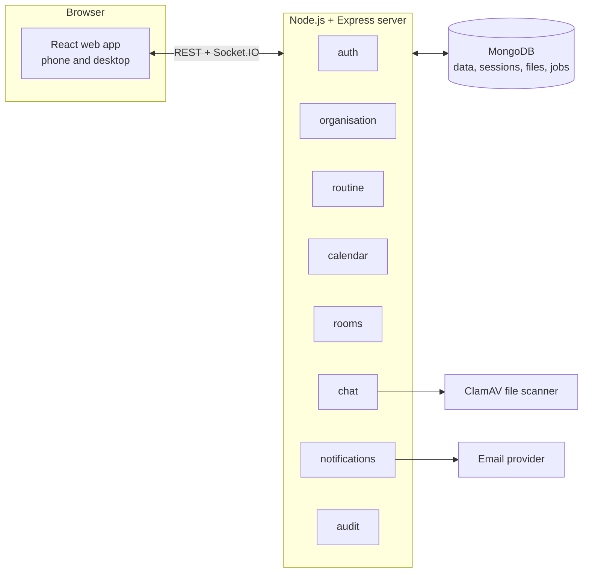

- Each server module does one job and talks to the others only through its own service functions.
- **Every action is checked on the server** by one permission function, using your account state, role and scope (department, section, semester). Hiding a button in the page is never the only protection.
- Live updates (new chat message, routine changed, booking changed, calendar changed) arrive by Socket.IO. Everything else is normal page requests.
- Everything is stored in MongoDB: accounts, sessions, rate limits, background jobs and uploaded files. No other database is needed.
- Every admin action is written to an **append-only audit log** that nobody can edit or delete.

---

## 4. Setting up the system (installer / super admin)

This part is for whoever installs and runs the system. Normal users can skip to section 5.

### 4.1 What you need

- **Node.js 24** (use 24.22.2 or later; 24.15.0 crashes the test runner on Windows).
- **MongoDB 7 or later, running as a replica set.** The server refuses to start without one.
- A transactional email provider (SMTP) with SPF, DKIM and DMARC set up, sending from a university-approved domain. See `docs/email-dns.md`.
- ClamAV for scanning uploaded files (production).

### 4.2 Install on a development computer

Run all commands from the repository root.

```sh
npm install                      # installs client, server and shared workspaces
```

Start a local MongoDB replica set once:

```sh
mongod --replSet rs0
# in another terminal, only the first time:
mongosh --eval "rs.initiate()"
```

Create `server/.env` by copying `server/.env.example`, then set at least:

```
MONGO_URL=mongodb://localhost:27017/crm?replicaSet=rs0
```

Keep the secret keys (email encryption key, HMAC key, session secret) **outside the database** and back them up (see `docs/key-backup.md`). Never commit `.env`.

### 4.3 Create the first super admin

```sh
npm run seed:super-admin -- --email you@baiust.ac.bd --name "Your Name"
```

The command prints a link. Open it to set the password. Then **create a second super admin** from the admin pages as soon as possible, so there is always a backup. The last super admin can never be removed.

### 4.4 Run it

```sh
npm run dev:server     # API on port 4000
npm run dev:client     # web app on http://localhost:5173
```

The client forwards `/api` and `/socket.io` to port 4000. In development, emails appear at `http://localhost:4000/dev/outbox` when `SMTP_USER` is empty.

### 4.5 Try it with demo data (optional, development only)

```sh
npm run seed:demo      # use a throwaway database; refuses to run in production
```

Every demo account uses the password `Demo@12345`. See `docs/demo-data.md` for the account list. Two demo routine sheets are in `docs/demo-import/` (one clean, one with deliberate mistakes) for practising the import.

### 4.6 Check and build

```sh
npm test               # all tests (they start their own in-memory database)
npm run lint
npm run build
npm run test:e2e -w @crm/client   # browser tests, only when needed
```

### 4.7 Go live

Production uses Docker Compose (Caddy web server, API, background worker, MongoDB replica set) or Render. Follow `docs/deploy.md`, `docs/deploy-render.md`, `docs/launch-checklist.md`, `docs/monitoring.md` and `docs/restore-runbook.md`. Targets: 99.5% uptime from 07:00 to 18:00 Sunday to Thursday, daily backups, and one restore test each semester.

### 4.8 First-time university setup (in order)

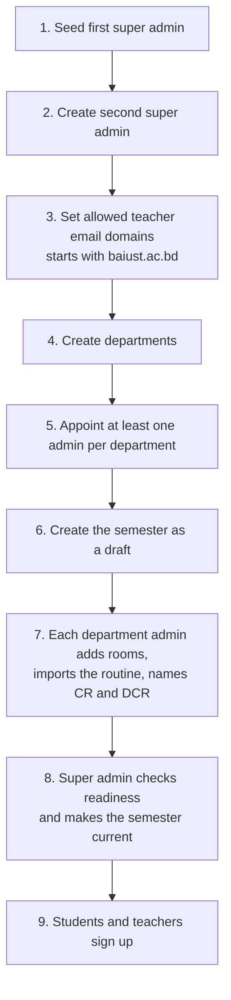

---

## 5. Getting in: sign-up, verification and sign-in

### 5.1 The public landing page (`/`)

A signed-out visitor sees the landing page: a hero with **Sign in** and **Sign up**, an example live-status card, an example week and a feature strip. Everything is marked **Example**; no real data is shown. A signed-in person at `/` goes straight to their own dashboard.

### 5.2 Who signs up how

| You are | Email you must use | Then |
| --- | --- | --- |
| Student | **Any** email (university or personal) | Verify email, then send a join request to your section |
| Teacher | **University** email on an allowed domain (for example `@baiust.ac.bd`) | Verify email, then wait for the department admin to approve |
| Admin | You do not sign up as admin | A super admin grants the role to your existing verified account (the first super admin is created at install) |

### 5.3 Sign-up steps

1. Open the app and press **Sign up** (`/signup`).
2. Choose **Student** or **Teacher**.
3. Enter your name, email and password. The password needs **at least 8 characters, with at least one letter and one number**.
4. Student sign-up shows a **CAPTCHA** (it is open to any email address).
5. Press **Create account**. The page `/check-email` tells you a link was sent.
6. Open the email and click the verification link. It works **once** and lasts **24 hours**. If it expires, ask for a new one from the sign-in or verify page.
7. After verifying, you are taken on to the next step for your role (below).

### 5.4 Sign-in (`/login`)

1. Enter your email and password and press **Sign in**.
2. The system sends you to the right page for your account state (join form, waiting screen, dashboard, and so on).

Things to know:

- **Wrong password:** after 5 wrong tries, each new try waits longer (1 s, 2 s, 4 s, up to 5 minutes) and a CAPTCHA appears. The account is never locked outright. After 10 failed tries in an hour the owner is emailed.
- **Sessions:** students and teachers stay signed in for up to 14 days without use. Admin sessions end after **30 minutes idle** or **12 hours total**. All sessions end when you change your password or your account is deactivated.
- **Deactivated or suspended accounts cannot sign in.**
- A new admin or a reset account may be sent to a **forced password change** page first.

### 5.5 Forgot your password

1. On the sign-in page choose **Forgot password** (`/forgot-password`) and enter your email.
2. Open the email and click the reset link. It works **once** and lasts **1 hour**.
3. Choose a new password (`/reset-password`). All your other sessions end.

If your email address no longer works, ask your department admin; they can reset a student's password as a fallback. A department admin who forgets their password is reset by a super admin, and a super admin by another super admin. Every reset is logged.

### 5.6 Changing your email or password

- **Password:** `Account > Password` (`/account/password`).
- **Email:** change it in your profile. The new address must be verified before it replaces the old one. A teacher's new address must also be on an allowed university domain. If your email bounces, you are asked to update it at next sign-in.

### 5.7 Sign-in flow summary

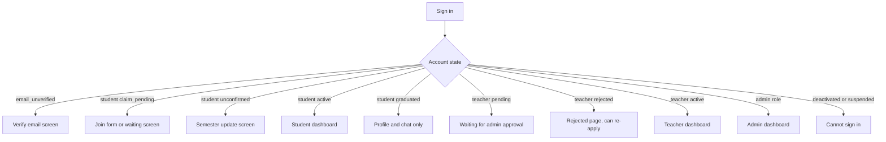

---

## 6. Student guide

### 6.1 First login: from sign-up to dashboard

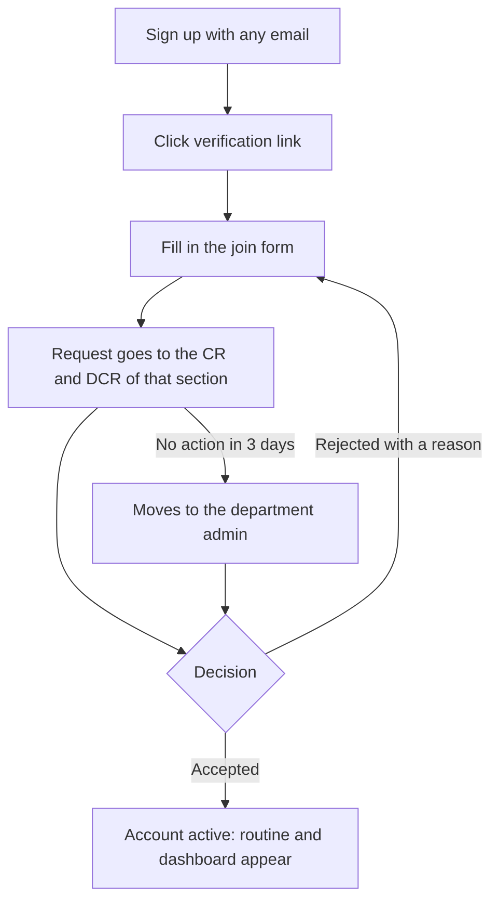

### 6.2 Fill in the join form (`/join`)

1. Enter your **name**, **department**, **level**, **term** and **section**. Add your **sessional (lab) group** if you know it; otherwise leave it empty.
2. You can only choose sections that already have a **CR**. A section with no CR is closed and does not appear. If yours is missing, ask your department admin to name its CR.
3. Press **Send request**. You may have **only one open request** at a time.
4. You then see the **waiting screen** (`/waiting-approval`). While you wait you can edit your profile and message the **CR and DCRs of the section you applied to** (nobody else). You cannot yet see the routine, rooms or the group.
5. You get an **email** when the request is accepted or rejected.

If you are **rejected**, read the reason and apply again with the right section or details. There is no limit on how many times you can apply. If you chose the wrong section but were accepted, ask your CR or the department admin to fix it; the admin can remove you from the section and you apply again.

If a CR or DCR does not answer within **3 days**, your request moves to the department admin.

### 6.3 Your profile (`/profile`)

You can edit:

- **Phone** and **profile photo**.
- **UV ID** (optional): your institutional ID, 1 to 20 digits, to help your CR recognise you. It is never checked and you can change or clear it at any time.
- **Email** (with re-verification).

Level, term, section and group are shown **read-only**, as accepted by your CR or DCR. To change your section, level or term, send a new join request. Only the CR, DCR or admin can change your lab group. Your profile also shows the semester you were last confirmed for (for example "Fall 2026").

### 6.4 Your dashboard (once active)

Cards, top to bottom:

1. **Right now:** **In class** or **Free**, a live countdown, and the current or next class (course, teacher's full name, room, time). On Friday and Saturday it says "No classes today". On calendar events it shows the event name (for example "Mid-term exam").
2. **Routine:** today's classes with the current one marked, a **Sunday to Thursday week grid** with today highlighted, and a preview of tomorrow's first class. On a phone the grid becomes a day-by-day list.
3. **Notices:** calendar events in the next 14 days, unread message count. Announcements and notifications appear when those features ship.
4. **Rooms:** free rooms now. Students can look but cannot request.
5. **My section:** your CR and DCRs (with a message button), this semester's courses with the teacher of **your** group, and join-request status.
6. **Profile reminders:** your level, term, section and group, the semester badge, and an email banner if your email is missing or unverified.

The status and countdown refresh by themselves every minute. You never need to reload.

### 6.5 My routine (`/routine`)

- You never pick a routine. It follows the department, level, term, section and **sessional group** your CR accepted.
- Theory classes are for the whole section. **Lab classes with a group tag (G1, G2…) show only to that group**, with that group's teacher, time and room.
- If your group is not set yet, you see the whole-section classes plus a notice asking your CR or DCR to set the group.
- When the admin publishes a change, your open page updates within 5 minutes, or immediately when the server pushes a change event.

### 6.6 Free rooms (`/rooms/free`)

Pick a **date** (this week or next week) and a **time range**. The page lists classrooms that are **Free**, **In use**, **Booked**, or **Availability unknown** (a department that uses that room has not published its routine yet). Booked rooms show only "Booked", never who holds them.

### 6.7 Chat (`/chat`)

- **One-to-one:** search a person by name (you see name, photo, department and role only) or start from a profile, the section roster or the CR card. Messages are plain text up to 4,000 characters, with sent, delivered and seen marks. You can delete your own message for everyone ("message deleted").
- **Section group:** one group per section per semester, named like "CSE 2-II-A · Fall 2026". You are added automatically when you are accepted. Teachers are not members. The CR and DCRs can delete messages and remove members.
- **Files:** attach PDF, Word, PowerPoint, Excel, plain text or image files up to **5 MB**. Files are scanned for malware first. SVG images and macro-enabled Office files are refused. Downloads use short-lived private links.
- **Safety:** **Block** someone (`/chat/blocked` lists blocked people), **report** a message or person with a reason, and know that an admin can **suspend** someone from sending messages. Admins cannot read private chats; they only see a reported message and a few around it.
- Messages and files are kept for **12 months**, then deleted.
- Chat is never emailed. You get an unread count and an optional browser notification.

### 6.8 Every new semester (semester update, `/semester-update`)

When a new semester becomes current, your account turns **unconfirmed**. On next sign-in:

1. You see the update screen, a join form **pre-filled** with last semester's values and the suggested next term (for example 2-I becomes 2-II).
2. Change anything that is different (a student who failed a term must change the term back; section and group may also change) and send it. Your new CR and DCRs accept it.
3. Until accepted, you can use your profile and one-to-one chat (with anyone), but not My routine, rooms or the section group. The old group stays readable.
4. If you finished 4-II, choose **I have completed my degree** to become *graduated*. If you are on a break, choose **Not enrolled this semester**; you stay unconfirmed with no reminders until you send a request.

Students not confirmed after 14 days appear on a follow-up list for the admin. Nobody is locked out by the deadline.

---

## 7. CR and DCR guide

A CR (one per section) and up to two DCRs are **students chosen by the department admin** for one section and one semester. They can do everything a student can, plus the following. The role ends at rollover, and the admin chooses again.

You do not apply to be CR or DCR. You do not send a join request to your own section; the admin's choice is your approval.

### 7.1 Your dashboard (`/cr/sections/:id`)

**Monitor**

- **Section roster:** names, UV ID (if given), lab group, photo and whether each student is confirmed this semester. You never see phone numbers or emails here.
- **Unconfirmed students**, with a **Remind** button (one reminder per student per day).
- **Section routine** and **live status** for the section and each lab group.
- **Free rooms** with a request button.
- **Room requests** and their status (pending, approved, rejected, cancelled, expired).
- **Flags** you sent to the admin: open, fixed or rejected.

**Act**

| Action | How |
| --- | --- |
| Accept a join request | Open the request, check the student's name, photo, email and UV ID, pick or correct the **sessional group**, press **Accept**. The student is emailed. |
| Reject a join request | A **reason is required**. The student can apply again. |
| Change a student's group | Any time in the semester. It is logged and the student is emailed. |
| Request a free room | See 11.4. You can have several requests and can cancel your own. |
| Flag a problem to the admin | For example wrong section or group, a missing student, or a routine mistake. Up to 5 a day. |

**Rules**

- If the CR and a DCR act on the same request, **the first action wins**; the other sees "already decided".
- Every action is logged with who and when, and the admin can see the log.
- Students you reject or remove can **appeal** to the admin, who can reverse the decision.

**You cannot:** delete or deactivate accounts, approve CR/DCR or teachers, edit routines, change a student's level, term or section, or see another section's students.

---

## 8. Teacher guide

### 8.1 First login

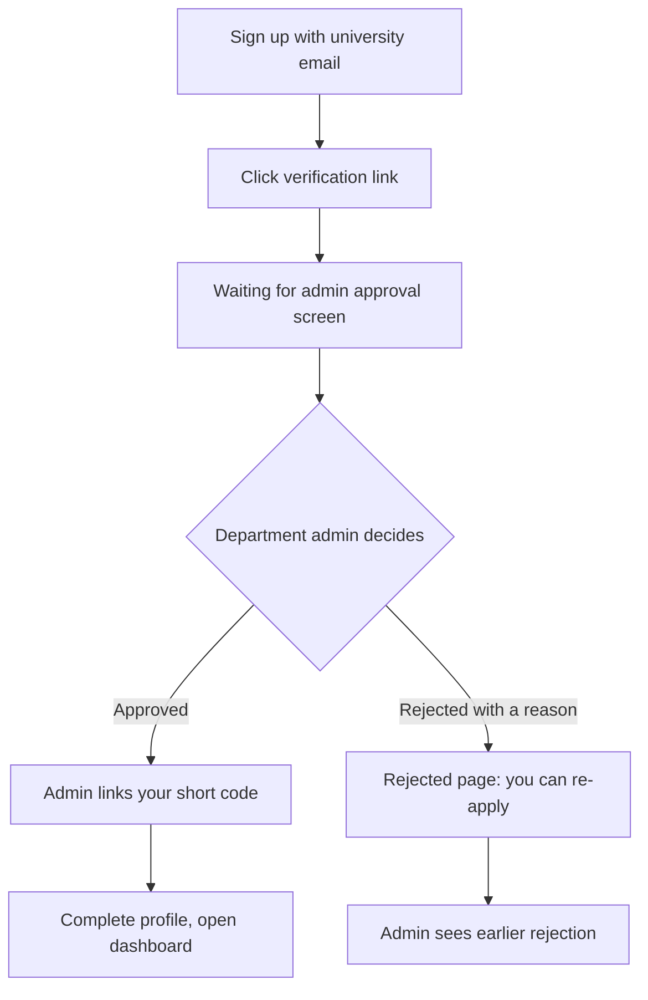

1. Register at `/signup` as a **teacher**, with your **university email**. Pick the **department** and your **short code** (for example `MYA`) from the routine sheet.
2. Verify your email.
3. Your account is **pending**. You can only sign in to see a "waiting for admin approval" screen.
4. The department admin approves or rejects (rejection has a reason). You get an email either way.
5. On approval your account is **active**, and the admin links it to your department and short code so your classes appear.

Teachers are identified by **department + short code**, so the same code in two departments is fine. If your account shows an "unlinked" notice, ask your admin to link it.

### 8.2 Your dashboard

1. **My status:** **Teaching** or **Free**, with countdown, and the current or next class (course, section, group, room, time). Shared labs show both teachers.
2. **My routine:** today's classes and a Sunday to Thursday week grid. Each cell shows course, section, group and room.
3. **Students:** the **roster** of each section you teach (name, UV ID if given, lab group). You cannot open the roster of a section you do not teach. The sections you teach are always worked out from the routine, never chosen by you.
4. **Rooms:** free-room view and **Request a room** buttons; **My room requests** with status.
5. **Messages and notices:** calendar events for the next 14 days and unread chat count.
6. **Account:** linked short code and name, plus reminders for a missing email, phone or photo.

### 8.3 What teachers can do

- Edit your profile, chat one-to-one and share files.
- Request a free room for a section you teach (section 11.4).
- Not possible: seeing any section's students outside those you teach, reading others' private chats, approving anyone, importing or editing routines.
- Later releases: seeing students' in-class or free status, a "free now" list, and sending announcements.

---

## 9. Department admin guide

A department admin works **for one department only**. The server blocks any action on another department. You are usually a teacher of the department; your single account holds both roles.

### 9.1 Admin dashboard (`/admin`)

Cards show what needs attention, newest first:

- Teacher registrations waiting.
- Join requests that need you (nobody acted in 3 days, or sent by a section's own CR or DCR).
- Reports from CR and DCR (flags).
- Routine problems from the last import that are still open.
- Room requests waiting for rooms you own (oldest first).
- Current semester and, if a draft exists, the **readiness checklist**.
- Unconfirmed students.
- Recent activity (latest audit entries).

You also get an email digest at **08:00 and 17:00** whenever something is waiting.

### 9.2 Start of every semester: the department checklist

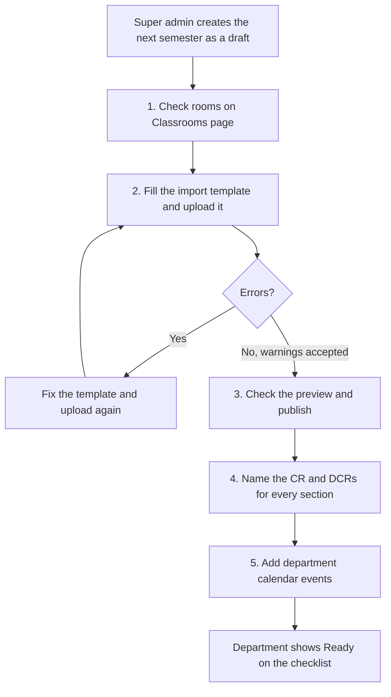

### 9.3 Classrooms (`/admin/classrooms`)

This is the **only** place rooms are created; the routine import never creates rooms.

- Add each room: **code** (for example `311`, `LR-407B`), **type** (classroom or lab) and **aliases** (spellings found in sheets, such as `RN: 311`).
- Add **sharing departments** for shared rooms. The admin of any owning or sharing department can decide that room's requests; the first decision is final.
- Room capacity is not tracked.

### 9.4 Import and publish a routine (`/admin/routine-import`)

1. Copy the department's Excel sheet into the **clean template** (one row per class slot). The columns are:
   - **Department, level (1–4), term (I or II), section (A, B, C; `A` for a one-section batch), group** (G1, G2… or empty for the whole section).
   - **Day** (Sunday to Thursday), **start** and **end** time in 24-hour form (for example 12:00 and 14:00).
   - **Course code** (required), **course name** (optional).
   - **Teachers** written as `department:code` (for example `CSE:AR`), joined by `+` for two teachers, or `TBA`.
   - **Room:** a code or alias that already exists on the Classrooms page.
   - A **second sheet** lists teachers (department, short code, full name).
2. Upload the file to the draft semester. The page shows a **preview** and a problem list.

| Problem | Kind | What to do |
| --- | --- | --- |
| Unknown teacher code | **Error** (blocks publishing) | Fix the code or add the teacher to the teacher sheet |
| Unknown room | **Error** | Add the alias on Classrooms, or ask the owning department to add the room |
| Missing field, bad time or day, end before start | **Error** | Correct the row |
| Teacher, room or section overlap | Warning | Confirm if it is a real combined class or shared lab; otherwise fix the typo |
| Teacher is `TBA`, a class before 8:30 or after 17:30, repeated course and group on one day | Warning | Check and accept |
| Another department already has the same slot for the same batch | Warning | Agree with that admin who deletes theirs |
| Class would clash with an approved booking | Warning | Decide whether to keep the class or the booking |

3. Fix problems in the template and upload again. **Nothing is visible to students until you publish with zero errors.**
4. Press **Publish** and confirm. Publishing creates the sections and groups and shows the routine to students.
5. **Re-import** a corrected sheet later for the same semester. The page shows what would change (including slots you edited by hand) and you choose what to keep. Affected people get one combined email.

**Slot ownership:** each slot belongs to the department that imported it, even if it is for another department's batch (for example CSE teaching a LAW class). A student's routine is the union of every department's slots for that batch. You can only change your own slots.

### 9.5 Edit the routine by hand (`/admin/routine-edit`)

- Pick a department, level, term and section. The grid looks like the student view; slots owned by another department are greyed out.
- **Add, edit or delete** slots your department owns. Every change goes through the same checks as the import. A change with an error cannot be saved.
- If a change clashes with an **approved room booking**, you are warned and choose to keep the class or cancel the booking; the requester is told.
- Changes to a published routine show to students immediately and are logged with old and new values.

### 9.6 Cancel one class

Cancel a single slot your department owns on **one date** (for example a sick teacher). Affected students and the teacher are emailed and the room becomes free for that slot. The weekly routine itself does not change.

### 9.7 Teachers (`/admin/teacher-registrations`, `/admin/teachers`)

- **Approve or reject** new registrations (a reason is required for rejection). After approving, **link** the account to the department and short code.
- **Suspend or deactivate** a teacher who leaves.
- The same department + code cannot be linked to two active accounts.

### 9.8 CR and DCR (`/admin/representatives`)

- Open a section, pick a student who has signed up and verified their email, and set the role **CR** or **DCR**. No accepted join request is needed.
- The system blocks a second CR or a third DCR and tells you why.
- A section opens for join requests only after you name its CR. The section group chat is created at that moment.
- For a new semester you see last semester's CR and DCRs and can **re-appoint with one action**.
- You can remove a role at any time.

### 9.9 Students (`/admin/students`)

Search for a student, then you can:

- Deactivate or reactivate the account, and mark a student graduated.
- **Remove a student from a section** (a reason is required). They go back to the waiting state and can apply again.
- Set a student's sessional group by hand (kept and logged).
- Decide **join requests** that no CR or DCR handled.
- Reset a student's password when their email no longer works.
- See students who are still unconfirmed and members removed from section groups.

Nothing is hard-deleted: deactivating keeps the history, so mistakes can be undone.

### 9.10 Flags and appeals (`/admin/flags`, `/admin/appeals`)

- **Flags** are problems CRs and DCRs reported. Mark each fixed or rejected.
- **Appeals** come from students a CR rejected or removed. You can reverse the decision.

### 9.11 Room requests (`/admin/room-requests`)

See 11.4. You decide up to **2 hours before the slot**. For each room and time you see the requester's section or department, the note and their other requests for the same time. **Approve one**, and the others for that room and time are rejected automatically. A request nobody decides by the cutoff is rejected as expired. After a slot you can add a note if the room was not used.

### 9.12 Calendar (`/admin/calendar`)

Create department-only events, for example a department fest. See 11.6. You cannot create or change university-wide events.

### 9.13 Reports and audit (`/admin/reports`, `/admin/audit`)

Read your **department's** audit log: every admin action with who, when, and old and new values. Chat reports about people in your department also arrive here, with only the reported message and a few around it. Each such view is audited. You can suspend a user from **sending chat messages** for a set time, with a reason.

### 9.14 Always remember

- Destructive actions (deactivate, remove a role, publish) ask you to **confirm** first.
- You cannot read anyone's private messages.
- You cannot create departments, semesters or admins.

---

## 10. Super admin guide

A super admin does everything a department admin can, in **any** department, plus the university-wide work below. There are always at least two super admins.

| Task | Page | Details |
| --- | --- | --- |
| Create, rename and retire departments | `/admin/departments` | These feed the join form and routine |
| Grant and remove admin roles | `/admin/admins` | Choose an existing verified account; roles are never self-service. The last super admin cannot be removed or demoted |
| Set allowed teacher email domains | Settings area | Starts with `baiust.ac.bd`; students are not limited by it |
| Create semesters | `/admin/semesters` | Create the next one as a **draft** with start and end dates |
| Make a semester current | `/admin/rollover` | Review the readiness checklist for every department first |
| University calendar events | `/admin/calendar` | Holidays, preparatory leave, exam days, early closings |
| Full audit log | `/admin/audit` | Every action in every department |
| Fix cross-department problems | Various | For example a teacher who works in two departments, or a room dispute |
| Recover a department without an admin | `/admin/admins` | You are emailed at once when a department has none |
| Reset an admin's password | `/admin/admins` | Logged; a super admin is reset by another super admin |

### 10.1 Rollover: making a new semester current (`/admin/rollover`)

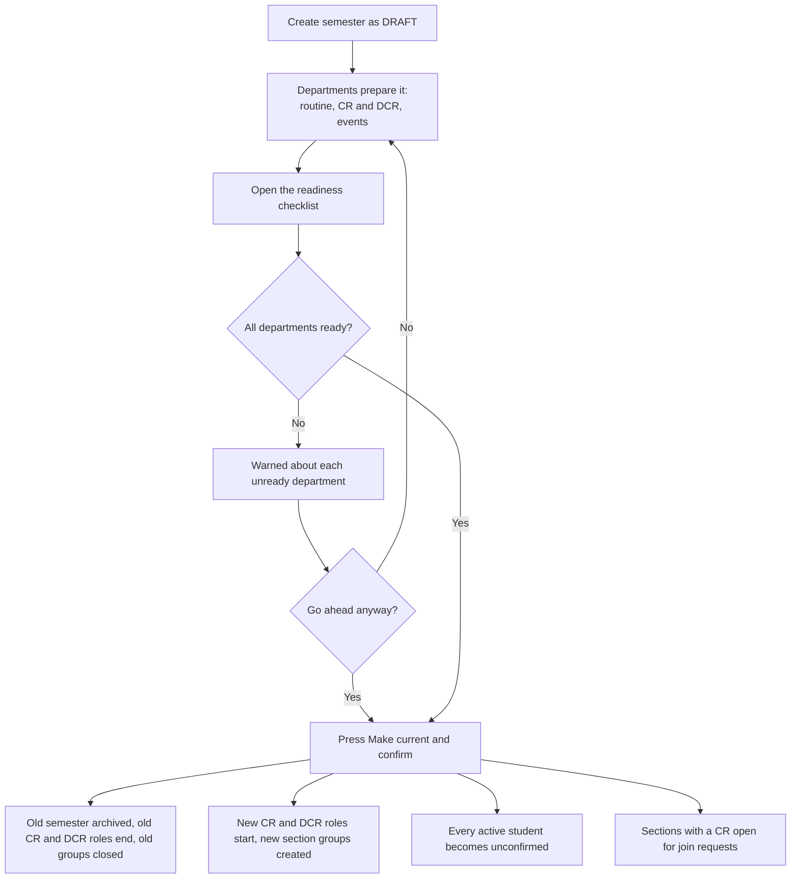

The checklist per department shows: sections created, routine imported and published with zero errors, a CR named for every section, and rooms listed. A department that is not ready can finish later; until then its students see "Your department is still setting up this semester". After 14 days, students who have not confirmed appear on the admin's follow-up list.

---

## 11. How the main features work

### 11.1 Join request (first action wins)

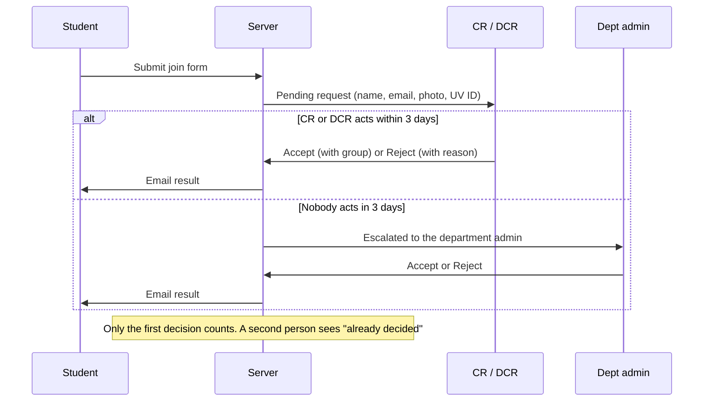

A request is `pending`, then `accepted`, `rejected`, `escalated` or `revoked`. Every request, acceptance, rejection, group change and removal is logged.

### 11.2 How your routine is chosen

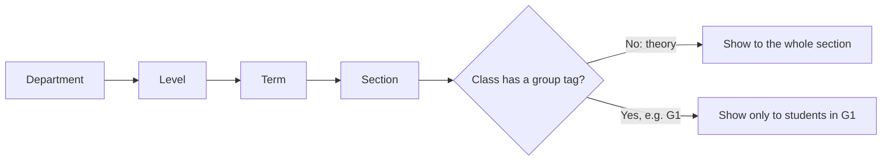

The server builds your routine from the five values your CR accepted. There are no electives, so nothing else is needed. A teacher's routine is built from the slots assigned to their linked short code.

### 11.3 Live status and countdown

1. The server tells the page the current Bangladesh time. The page works out how far your device clock differs once and corrects for it.
2. It finds a slot for your section (or your group) on today's day whose time contains now.
3. A match means **In class**; no match means **Free**, with the next class time.
4. The **calendar overrides**: a holiday, preparatory leave or exam day shows the event name; after an early-closing cutoff it shows "Classes over today"; outside the semester it shows "No classes"; a cancelled class counts as free; an approved room booking counts as a class; Friday and Saturday show "No classes today".
5. Each minute the page recalculates by itself. It refetches the data every 5 minutes, when the tab becomes visible again, and straight away when the server announces a routine, booking or calendar change.

### 11.4 Room requests and booking (R2)

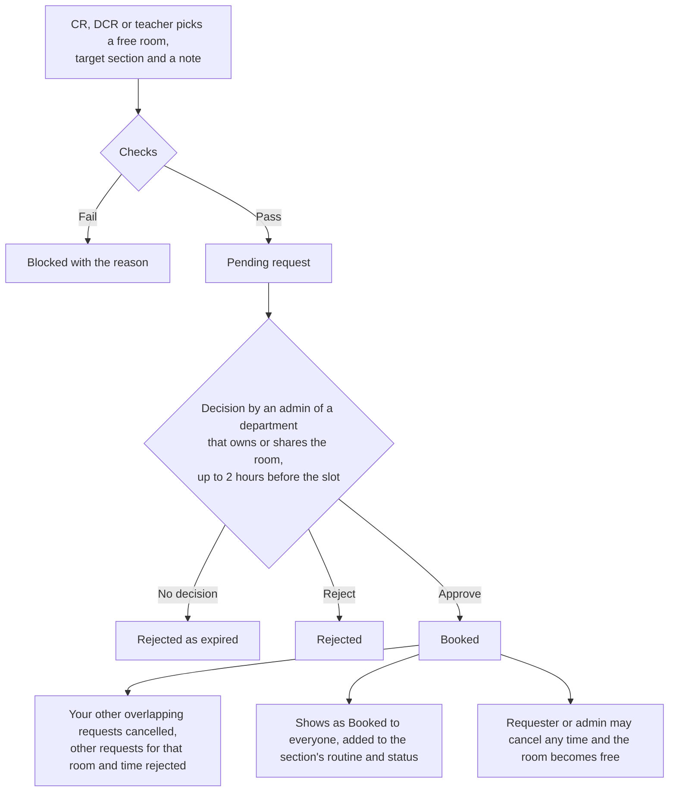

**To request a room** (CR, DCR or approved teacher): open the free-room view, pick a free room, choose the **target section** (and group if only one group attends), write a **note**, and press **Request**. A CR or DCR may name the teacher taking the class. Students cannot request rooms.

**A request is one room, one date and one time range.** Times are on 5-minute steps, last 30 minutes to 3 hours, and sit between 08:00 and 18:00.

**Checks (all must pass, and the server repeats them on approval):**

1. The room is free (no routine class, no approved booking at that time).
2. The room's availability is known (every department using it has published).
3. The target section or group is free.
4. The teacher is free.
5. It is a teaching day: Sunday to Thursday, inside the semester, and not stopped by a calendar event.
6. At least **12 hours** before the start.
7. The date is in the **current or next week**.
8. Not over the limit: at most **3 open requests that overlap each other** (shared by a section's CR and DCRs).

After approval, the class shows in the target section's routine on that date only, and affected students and the teacher are emailed. No double-booking is possible: the database itself refuses a second booking for the same room and time block.

### 11.5 Routine import in one picture

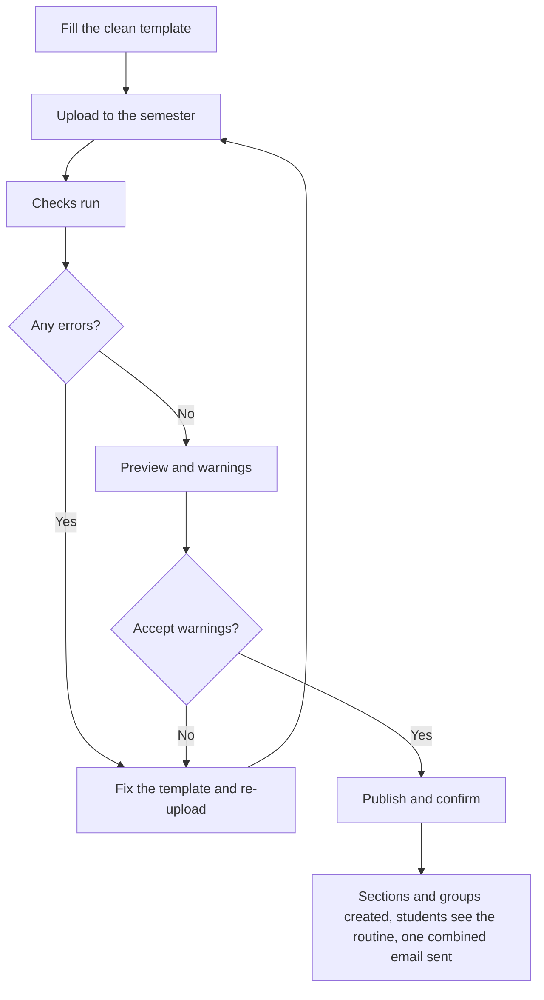

### 11.6 University calendar

An event has a **scope** (university or one department), a **date range**, a **kind** and a **label**.

| Kind | Effect |
| --- | --- |
| `holiday`, `prep_leave`, `exam` | No regular classes all day. Rooms cannot be requested. Approved bookings on those dates are cancelled |
| `early_closing` | Classes before the cutoff run; later classes do not (for example "classes up to 12 p.m.") |
| `dept_event` | Like a holiday (or early closing if it has a cutoff) for one department only |

Overlapping events: the **strictest wins**. Students and teachers see events for the next 14 days on their dashboard. Adding an event that affects approved bookings first shows the list of affected bookings.

### 11.7 Chat checks

Before a message goes through, the server checks that both people's account states allow chat, neither has blocked the other, and the sender is not chat-suspended. Files must pass the type check (from content, not the extension), the 5 MB limit and the ClamAV scan before anyone can download them.

---

## 12. Account states: what each one can use

**Student states**

| State | Meaning | Gets there by |
| --- | --- | --- |
| `email_unverified` | Signed up, email not verified | Sign-up |
| `claim_pending` | Verified, not yet accepted into a section | Verifying email, or removal from a section |
| `active` | Accepted for the current semester | CR/DCR accepts |
| `unconfirmed` | Accepted before, not yet for this semester (includes students on a break) | A new semester becomes current |
| `graduated` | Finished the degree | Student chooses it after 4-II, or the admin marks them |
| `deactivated` | Removed by an admin; history kept | Admin action |

**Teacher states:** `email_unverified`, then `pending`, then `active`. An admin can also set `suspended` or `deactivated`.

| Can use | Unverified | Waiting (`claim_pending`) | `unconfirmed` | `active` student | `graduated` | Teacher `pending` | Teacher `active` |
| --- | --- | --- | --- | --- | --- | --- | --- |
| Sign in | Verify screen only | Yes | Yes | Yes | Yes | Waiting screen only | Yes |
| Edit profile | No | Yes | Yes | Yes | Yes | Yes | Yes |
| Send join request | No | Yes | Yes | No | No | n/a | n/a |
| My routine and live status | No | No | No | Yes | No | No | Yes (own classes) |
| Free-room view | No | No | No | Yes | No | No | Yes |
| Request a room | No | No | No | CR/DCR only | No | No | Yes |
| One-to-one chat | No | Only with the CR and DCRs of the section applied to | Anyone | Anyone | Anyone | No | Anyone |
| Section group | No | No | Old group read-only | Yes | Old groups read-only | n/a | n/a |
| Share files | No | No | One-to-one only | Yes | No | No | Yes |
| Roster | No | No | No | CR/DCR, own section | No | No | Sections taught |

Chat suspension is a separate flag that only stops sending messages. `deactivated` and `suspended` accounts cannot sign in.

---

## 13. Page map (where to find things)

| Page | Address | Who |
| --- | --- | --- |
| Landing page | `/` | Everyone (signed-out visitors); signed-in people go to their dashboard |
| Sign in / Sign up | `/login`, `/signup` | Visitors |
| Check your email / Verify | `/check-email`, `/verify`, `/verify-email`, `/confirm-email` | New accounts |
| Forgot / reset password | `/forgot-password`, `/reset-password` | Anyone |
| Join form | `/join` | Student awaiting a section |
| Waiting for approval | `/waiting-approval` | Pending student or teacher |
| Teacher rejected | `/teacher-rejected` | Rejected teacher |
| Semester update | `/semester-update` | Unconfirmed student |
| Forced password change | `/change-password` | Accounts told to change it |
| Profile | `/profile`, `/users/:id` (public profile) | Everyone signed in |
| Change password | `/account/password` | Everyone signed in |
| My routine | `/routine` | Active students, active teachers |
| Free rooms | `/rooms/free` | Active students, active teachers |
| CR/DCR dashboard | `/cr/sections/:id` | CR, DCR |
| Chat | `/chat`, `/chat/new`, `/chat/:id`, `/chat/blocked` | Allowed account states |
| Admin dashboard | `/admin` | Admins |
| Teacher registrations / Teachers | `/admin/teacher-registrations`, `/admin/teachers` | Department admins, super admins |
| Students | `/admin/students` | Department admins, super admins |
| CR and DCR | `/admin/representatives` | Department admins, super admins |
| Classrooms | `/admin/classrooms` | Department admins, super admins |
| Routine import / edit | `/admin/routine-import`, `/admin/routine-edit` | Department admins, super admins |
| Room requests | `/admin/room-requests` | Department admins, super admins |
| Calendar | `/admin/calendar` | Department admins (own events), super admins (all) |
| Flags / Appeals / Reports | `/admin/flags`, `/admin/appeals`, `/admin/reports` | Department admins, super admins |
| Audit log | `/admin/audit` | Department admins (own department), super admins (all) |
| Departments / Admins / Semesters / Rollover | `/admin/departments`, `/admin/admins`, `/admin/semesters`, `/admin/rollover` | Super admins |

If you open a page you are not allowed to use, the server refuses it even if you type the address by hand.

---

## 14. Privacy and safety

- **Email and phone are private.** Only the owner sees their own. The two exceptions: the CR/DCR sees a student's email on that student's join request, and the admin sees a teacher's email on their registration request. They never appear on profiles, rosters, chat or admin lists.
- **Passwords** are stored hashed and never shown. Admins use the same sign-in with no second step.
- **Search shows little:** only name, photo, department and role.
- **Admins cannot read private messages.** The only exception is the reported-message view, which is audited.
- **Messages** are encrypted on the server, not end-to-end, because reporting needs the server to produce a reported message. Messages and files are deleted after 12 months. A message you delete is erased for good after 30 days unless a report refers to it.
- **Files** are scanned for malware before they can be downloaded and are never public.
- **Auditing:** every admin action is logged and cannot be edited or deleted.
- **Teachers** see only the rosters of sections they teach. **CRs** see only their own section.
- Never share your password, and sign out on shared computers.

---

## 15. Troubleshooting and FAQ

| Problem | What to do |
| --- | --- |
| I did not get the verification email | Check spam, then ask for a new link. Links last 24 hours and work once |
| My reset link says it expired | Reset links last 1 hour and work once; request a new one |
| The teacher sign-up rejects my email | Teachers need a university-domain email. Ask a super admin if your domain should be allowed |
| I cannot find my section on the join form | Its CR has not been named yet. Ask your department admin |
| My request is still waiting | Ask the CR or DCR in chat. After 3 days it moves to the department admin |
| My request was rejected | Read the reason and apply again with the right section and group |
| I see the whole-section classes only | Your lab group is not set. Ask your CR or DCR to set it |
| I am in the wrong section or group | Ask your CR (group) or the department admin (section) |
| I can no longer see my routine after a new semester began | You are `unconfirmed`. Open the update screen and send a new join form |
| A room I want shows "Availability unknown" | A department that uses it has not published its routine yet, so it cannot be requested |
| My room request was blocked | The reason is shown: room or section busy, under 12 hours ahead, outside this or next week, not a teaching day, or 3 overlapping requests already open |
| I am told "already decided" | Someone else decided first. First action wins |
| I cannot send chat messages | You may be chat-suspended or blocked, or your state does not allow chat |
| My file was rejected in chat | Check the type, the 5 MB limit, and that it is not an SVG or macro-enabled Office file |
| The time looks wrong | The app uses Bangladesh time from the server, not your device clock |
| My teacher dashboard says "unlinked" | Ask your department admin to link your short code |
| A department admin has left | A super admin is alerted and appoints a new one |
| I am locked out as the only super admin | Use the installer's recovery steps in `docs/restore-runbook.md`; this is why two super admins are required |

Server problems (for the installer): `Server refuses to start` means MongoDB is not a replica set or `MONGO_URL` is missing the `replicaSet=` option. `Tests crash on Windows` can mean a bad Node version; use 24.22.2 or later.

---

## 16. Semester calendar: the yearly routine

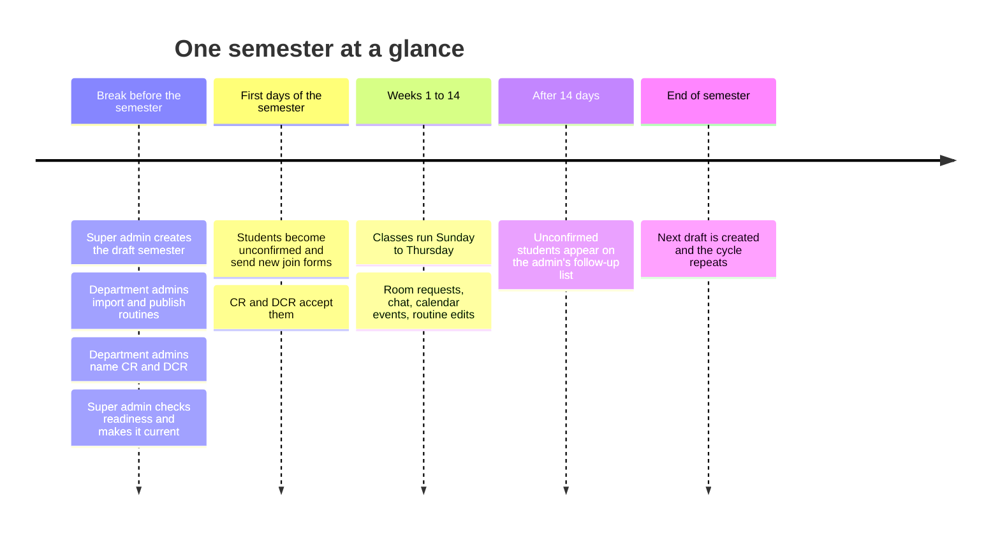

**Quick checklist by role**

- **Student:** sign up, verify, join form, wait for acceptance, use the dashboard. Every semester, send the update.
- **CR/DCR:** accept join requests, set groups, check the roster, request rooms, flag problems.
- **Teacher:** sign up with university email, wait for approval, check your routine and rosters, request rooms.
- **Department admin:** rooms, routine import and publish, CR/DCR, teacher approval, room decisions, calendar.
- **Super admin:** departments, admins, semesters, rollover, university calendar, audit.
